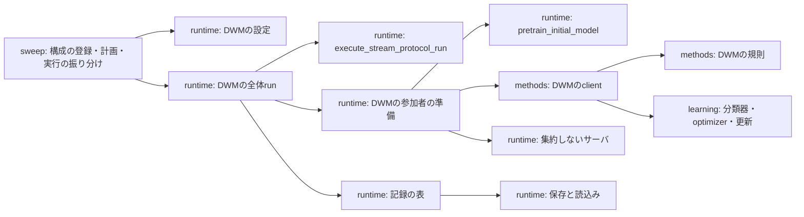

# Design Document

## Overview
単一モデルFedAvg（構成`fedavg`）の学習器を専門家にしたDynamic Weighted Majority（Kolter & Maloof, JMLR 8, 2007の図1）を、新しい構成`dwm-neural-network`として追加する。FedAvgの全体runと同じ形（設定→参加者の準備→実行の枠→指標→保存→掃引）の別のモジュール群を作り、既存のFedAvg・FedDrift・FedHASPのモジュールは、掃引の振り分けの登録以外は変えない。

### Goals
- `fedavg`と同じ学習器・同じ入力の系列で、DWMの専門家の追加・削除と重み付き投票だけを足した比較手法を動かす。
- 予測→学習の評価で、評価の予測は学習の前の重みで行い、学習の手順は図1のとおりにする。
- 既存の掃引コマンドで計画・実行・保存・一覧・再開ができる。

### Non-Goals
- 専門家の連合学習での集約、β・θ・pの掃引軸、DWM以外の手法、既存の構成の値の変更。

## Boundary Commitments

### This Spec Owns
- DWMのclient（専門家・重み・標本の保持、予測、図1の学習の手順）と、その純粋な規則（投票、周期ごとの重みの更新・削除・追加の判断）。
- DWMのrunの設定、参加者の準備、集約しないサーバ、計測つきの全体run、指標、記録の表、保存と読込み。
- 構成`dwm-neural-network`の登録と、掃引の計画・実行・保存・既存の結果の判定への振り分け。

### Out of Boundary
- 系列の生成、事前学習、分類器・optimizer・ミニバッチの更新の部品（既存をそのまま使う）。
- 既存の構成の設定・runの識別子・保存形式・golden。

### Allowed Dependencies
- `learning/models`（分類器、パラメータのsnapshot、計算の計測）、`learning/training`（`update_independent_model_parameters`、`ParameterOptimizerState`、事前学習の設定）、`runtime/initial_model_pretraining.pretrain_initial_model`、`runtime/single_run_execution.execute_stream_protocol_run`、`evaluation`（共通の指標の計算、通信量の記録、計算量の要約）、`runtime/fedavg_run_settings.build_default_fedavg_run_settings`（`fedavg`と同じ値を取り出すためだけ）。
- `methods/fedavg`には依存しない（FedAvgのclientを継承・再利用しない。同じ部品を同じ順で呼ぶ）。

### Revalidation Triggers
- `fedavg`の学習器の設定（事前学習、構造、optimizer、batch、更新の回数）が変わると、DWMの専門家も変わる（同じ値を取り出すため）。Requirement 1.5の一致testで検出する。
- 実行の枠（`execute_stream_protocol_run`）の呼出し順の変更。

## Architecture

### Existing Architecture Analysis
- `fedavg`は`runtime/fedavg_*`（設定・参加者・サーバ・全体run・記録の表・保存）と`methods/fedavg/fedavg_client.py`から成り、`sweep/`の3つのファイル（構成の登録、計画の型、実行の振り分け）で掃引へつながる。runの一覧のCSVは、runのJSONの`run_metrics`から共通の処理で作られる。
- FedAvgのclientは、構造`independent_models_without_shared_backbone`の事前学習済みの分類器を1つ持ち、到着した全標本を保持し、保持数がbatch（32）以上なら、標本ごとに1回、`python_random_generator.sample(保持, 32)`で抜いたbatchで`update_independent_model_parameters`する。

### Architecture Pattern & Boundary Map


### Technology Stack
- 既存と同じ（Python、PyTorch CPU、NumPy）。新しい外部の依存は無い。

## File Structure Plan

### Directory Structure
```
src/federated_learning_experiments/
  methods/dynamic_weighted_majority/
    __init__.py
    dynamic_weighted_majority_rules.py        # 投票と、周期ごとの重みの更新・削除・追加の判断（純粋な関数）
    dynamic_weighted_majority_client.py       # 専門家・重み・保持標本・記録を所有し、標本ごとの予測と学習を行う
  runtime/
    dynamic_weighted_majority_run_settings.py             # 参加者の設定とrunの設定、既定の組立て（fedavgの値を取り出す）
    dynamic_weighted_majority_run_server.py               # 集約・配布しないサーバ（通信量0の記録）
    dynamic_weighted_majority_run_participant_factory.py  # 事前学習1回とclient・サーバの準備
    dynamic_weighted_majority_experiment_run.py           # 計測つきの全体runと指標の導出
    dynamic_weighted_majority_run_record_tables.py        # 記録の名前付きの配列
    dynamic_weighted_majority_run_artifact_files.py       # JSON・NPZの保存と読込み
tests/refactoring/
  test_dynamic_weighted_majority_rules.py
  test_dynamic_weighted_majority_client.py
  test_dynamic_weighted_majority_experiment_run.py
  test_dynamic_weighted_majority_experiment_sweep.py
```

### Modified Files
- `src/federated_learning_experiments/sweep/experiment_configurations.py` — 構成名の定数を一覧の末尾へ足し、runの設定の組立てを振り分ける。どの名前にも当たらないときはFedSDAの構成を返す既定の経路があるので、DWMの分岐はそれより前に置く。保存の振り分け（`experiment_sweep_execution.py`）にも`else`が無いので、DWMの分岐を明示し、どの型にも当たらなければ例外にする。
- `src/federated_learning_experiments/sweep/experiment_sweep_plan.py` — runの設定の型の和にDWMの設定を足す。
- `src/federated_learning_experiments/sweep/experiment_sweep_execution.py` — 型の検査、実行と保存、既存の結果の読込みの振り分けにDWMを足す。既存の結果の読込みは、今は「FedAvgでもFedDriftでもなければFedSDAの読込み」へ落ちる形なので、DWMの型を明示の分岐として先に足す（DWMの結果がFedSDAの読込みへ渡らないようにする）。
- `tests/refactoring/test_single_run_dependency_boundaries.py` — 新しいmoduleの依存の許可集合を登録する。
- `tests/refactoring/fresh_process_smoke.py` — DWMの小さい全体runと保存・読込みの流れを足す。
- 構成の名前の一覧を固定で照合している既存のtest（既存の名前と順は変えず、末尾の1つを足すだけ）:
  - `tests/refactoring/test_fedsda_configuration_variants.py` — 一覧の完全一致（`EXPERIMENT_CONFIGURATION_NAMES == (...)`）の末尾に足し、FedSDAの変種の集合の差（`set(CONFIGURATION_VARIANTS) == set(...) - {...}`）の除外に足す。
  - `tests/refactoring/test_fedsda_configuration_candidate_settings.py` — 全構成名を回してFedSDAのrunの設定であることを確かめるtestが、FedAvg・FedDriftの設定の型を除外している。その除外へDWMの設定の型を足す。
  - `tests/refactoring/test_soft_training_single_model_prediction.py` — 一覧が「固定の既存の構成＋`fedsda-soft-training-single-model-prediction`」で終わるという照合を、その後に`dwm-neural-network`が続く形へ直す。
  - `tests/refactoring/behavior_golden_cases.py` — goldenの事例にしない構成の表`CONFIGURATIONS_PROTECTED_WITHOUT_GOLDEN`へ、`dwm-neural-network`と、それを守る専用のtestのファイル`tests/refactoring/test_dynamic_weighted_majority_experiment_run.py`を足す（`test_important_behavior_regression_goldens.py`は、構成の全部がgoldenか、この表のどちらかにあることと、表のファイルが実在することを確かめる）。goldenの事例と既存のgoldenのファイルは変えない。
- `docs/experiments/experiment-sweep.md` — 構成の一覧に`dwm-neural-network`を足す。

## System Flows

標本の処理（clientの中で。実行の枠が渡す`sample_index`は0から数えるので、図1のiは`sample_index + 1`。記録する標本の位置は、すべて`sample_index`（0から）で書く）:
1. 入力を検査する（状態の変更・乱数の消費の前）。
2. 各専門家（作られた順）の予測クラスを求める（no_grad、1回のforward）。
3. その時点の重みで投票し、全体の予測を決めて記録する（評価に使う。同点はクラスの番号が最小）。
4. iがpの倍数なら: 予測を誤った専門家の重みにβを掛ける→その重み（減衰の直後、正規化と削除の前）で投票し直す→最大の重みで全重みを割る→重みがθ未満の専門家を消す（最大は1なので、少なくとも1つ残る。消された位置として`sample_index`を記録）→投票し直した予測が誤っていれば、事前学習の直後の状態の複製を重み1で足す（作られた位置として`sample_index`を記録）。
5. 標本を全専門家（作られた順。足したばかりの専門家を含む）の保持へ加え、保持数がbatch以上の専門家ごとに、`python_random_generator.sample(保持, batch)`で抜いたbatchで`updates_per_sample`回更新する（専門家の作られた順。専門家ごとに続けて行う）。DWMは図1のとおり毎標本で学習するので、FedAvgの`local_update_interval_per_client_samples`（局所更新をまとめる間隔）に当たる設定は持たず、間隔1（毎標本）に固定する。`fedavg`の既定もこの値は1。
6. 2〜5で真のコンセプトは使わない（記録だけ）。

公式の実装（`DWM.java`）との違いは、新しい専門家を何も学習していない学習器ではなく事前学習の直後の神経網の複製にすることだけ（research.md）。評価の予測を学習の前の重みで行う扱いと、同点の扱いは公式の実装と同じ。

乱数の消費はbatchの抽出だけで、専門家の作られた順に行う。専門家が1つのまま増減しない場合、FedAvgのclientと同じ順・同じ回数になる（Requirement 1.5）。

## Requirements Traceability
| 要求 | 実現する部品 |
|---|---|
| 1.1, 1.2 | 設定の既定の組立て（`fedavg`の値を取り出す）、参加者の準備（構造`independent_models_without_shared_backbone`で事前学習1回） |
| 1.3, 1.4 | client（初期状態の複製、保持と更新の条件） |
| 1.5 | clientの一致test（p>標本数でFedAvgのclientと比べる） |
| 2.1〜2.4 | 規則（投票、周期の更新）とclient（手順の順序） |
| 2.5 | 設定の固定値とrunのJSON |
| 2.6, 2.7 | clientの入力の検査と、真のコンセプトを記録だけに使うこと |
| 3.1〜3.3 | clientの独立、集約しないサーバ、実行の枠 |
| 4.1〜4.4 | 全体runの指標、記録の表、保存と読込み |
| 5.1〜5.4 | 掃引の3ファイル、構成の一覧の文書 |

## Components and Interfaces

### methods
#### `dynamic_weighted_majority_rules`
- `vote_weighted_majority(*, expert_predicted_class_ids: tuple[int, ...], expert_weights: tuple[float, ...], class_count: int) -> int` — 重み付き投票。同点は最小のクラス。専門家が0なら拒否。
- `update_weights_at_period(*, expert_predicted_class_ids, expert_weights, observed_class_id, class_count, weight_decrease_factor, removal_weight_threshold) -> DynamicWeightedMajorityPeriodUpdate` — 図1の8〜9行目と12〜19行目の判断を一度に行う純粋な関数。戻り値は、減衰・正規化の後の重み（専門家の順）、残す専門家の位置、投票し直した全体の予測、新しい専門家を足すかの真偽。

#### `DynamicWeightedMajorityClient`
- 初期化: client ID、事前学習の直後の分類器と、そのoptimizerの状態（`pretrain_initial_model`が返す`concept_specific_parameter_optimizer_state`。構造`independent_models_without_shared_backbone`では全パラメータがこちらに入り、FedAvgのfactoryも同じものを使う。`shared_parameter_optimizer_state`は使わない）、β・θ・p、batch、標本ごとの更新の回数、Pythonの乱数。受け取った初期状態をclientの中で複製して保ち（以後の学習の影響を受けない元）、初期の専門家（ID 0、重み1）と、後で足す専門家は、この元の複製で作る。複製は、`FedavgClient`と同じく、分類器とoptimizerの状態の組を1回の`deepcopy((classifier, optimizer_state))`でまとめて行う（別々に複製すると、optimizerが複製でない方の分類器のパラメータを持ったままになり、専門家が学習されない）。元を保つときも、専門家を作るときも、この組の複製にする。
- `process_observed_sample(*, observed_sample, sample_index, evaluation_concept_id)` — 上のSystem Flowsの1〜5。
- `flush_pending_local_updates`・`has_model_ready_for_server_registration`・`advance_new_model_upload_wait_after_synchronization` — 実行の枠が呼ぶ操作。学習は標本ごとに済ませるので、何もしない。
- 専門家: `DynamicWeightedMajorityExpert`（専門家ID（clientの中で0から作られた順）、分類器、optimizerの状態、保持標本、重み、学習の計数（`trained_sample_count`・`parameter_update_step_count`））。現在の専門家を`experts`（作られた順）に持つ。
- 記録: `sample_predictions`（`DynamicWeightedMajoritySamplePrediction`: `sample_index`、全体の予測、観測のクラス、真のコンセプト、正誤、予測の時点の専門家の数、予測の時点で重みが最大の専門家のID（同点は最小のID））、`expert_lifetimes`（`DynamicWeightedMajorityExpertLifetime`: 専門家ID、作られた`sample_index`（初期の専門家は-1）、消された`sample_index`（最後まで残ったものは-1））。学習の計数は専門家（`DynamicWeightedMajorityExpert`）が持ち、`model_training`の表へ書く（消された専門家の分も、消される時点の値を残す）。記録のobjectとNPZの表で、残ったものの値はどちらも-1にそろえる。

### runtime
- `DynamicWeightedMajorityRunParticipantSettings`（事前学習の設定、隠れ層、optimizer、batch、標本ごとの更新の回数、β、θ、p）と`DynamicWeightedMajorityRunSettings`（実行の設定、参加者の設定、指標の設定）。`build_default_dynamic_weighted_majority_run_settings(*, experiment_run_conditions)`は`build_default_fedavg_run_settings`の結果から実行・事前学習・構造・optimizer・batch・更新の回数・指標の設定を取り出し、β=0.5、θ=0.01、p=50を足す。
- `DynamicWeightedMajorityRunServer` — 実行の枠の契約（`RunServerOperations`）の3つの操作`record_client_states_before_synchronization`・`synchronize_models`・`finalize_started_communications`を持ち、どれもパラメータを動かさない。`synchronize_models`ごとに通信量0のsnapshot（`CommunicationVolumeRecordStore`に何も記録しない状態）と同期の回数を記録する。
- `DynamicWeightedMajorityRunParticipantFactory` — FedAvgと同じ検査と事前学習（構造`independent_models_without_shared_backbone`）を1回行い、各clientへ同じ初期状態を渡す。
- `execute_dynamic_weighted_majority_experiment_run(*, run_settings) -> DynamicWeightedMajorityExperimentRun` と `derive_dynamic_weighted_majority_run_metrics(...) -> DynamicWeightedMajorityRunMetrics`。
  - 指標の項目と名前はFedAvgの`FedavgRunMetrics`と同じにする（runの一覧のCSVで構成をまたいで同じ列にするため）。DWMでの意味: `final_global_model_count`＝全clientの最後に残った専門家の数の合計（名前は他の構成との共通の列として残し、DWMでは「全体のモデル」ではなく専門家の数であることをdocstringと構成の一覧の文書に書く）、`final_parameter_value_count`・`final_parameter_byte_count`＝その全専門家のパラメータの合計、`held_model_sample_count`＝標本ごとの予測の時点の専門家の数の全clientの合計、`processed_sample_count`＝処理した標本の数。`communication_volume`＝0（何も記録しないsnapshot）、`server_computation_counts`の集約・統合・診断の計数＝0、`client_consolidation_parameter_multiply_accumulate_count`＝0、`computation_cost_summary`＝FedAvgと同じ共通の関数で、上の計数と`processed_sample_count`・`held_model_sample_count`から求める。
  - 切替の検出の指標: FedAvgと同じく、検出の位置の列を全clientで空（検出0件）として共通の`calculate_detection_metrics`で計算する（欠損にはしない）。DWMはモデルの切替を持たないため。
  - 計算の計数: FedAvgと同じ実計測器（`measure_model_computation`）で、事前学習の後から全体runの終わりまでを数える。DWMで数えられるのは、専門家ごとの予測のforwardと学習のforward・backward。FedAvgのclientが行う損失の統計のためのforwardは、DWMには無い（その分、FedAvgより少ない）。
  - 計測の包み（FedAvgの`_PreparationMeasuringParticipantFactory`・`_RoundMeasuringServerOperations`、いずれも非公開）は、依存の境界の規約（非公開名のimportの拒否）に従い、DWMのmoduleの中に同じ働きの非公開のclassとして書く。共通の部品への切り出しは、既存のFedAvgの変更になるのでこのspecでは行わない。
- `build_dynamic_weighted_majority_run_record_tables`、`save_dynamic_weighted_majority_experiment_run`、`load_dynamic_weighted_majority_run_artifacts`。

## Data Models
- 保存するNPZの表（FedAvgの`build_fedavg_run_record_tables`の表と同じ名前・同じ形を基本にし、DWMに無いものと足すものを明示する）:

| 表の名前 | FedAvg | DWM |
|---|---|---|
| `sample_prediction.{sample_index, predicted_class_id, observed_class_id, observed_concept_id, prediction_is_correct}` | `[client, sample]` | 同じ |
| `sample_prediction.prediction_model_id` | 常に0 | 予測の時点で重みが最大の専門家のID（同点は最小のID）。全体の予測は投票なので、診断用 |
| `sample_prediction.held_model_count_at_prediction` | 常に1 | 予測の時点の専門家の数 |
| `generated_concept.concept_id`、`concept_change.{client_id, sample_index}` | あり | 同じ |
| `synchronization.round_index`、`synchronization.communication_volume.*`、`synchronization.aggregation_parameter_multiply_accumulate_count` | あり | 同じ名前。通信量と集約の計数は0 |
| `synchronization.global_model_count`、`synchronization.client_held_model_count` | 1 | 同期の時点の全clientの専門家の数の合計、clientごとの専門家の数 |
| `round_model_computation.*`、`model_computation.{preparation, finalization}.*` | あり | 同じ |
| `model_training.{client_id, model_id, trained_sample_count, parameter_update_step_count, prediction_forward_call_count, statistics_forward_call_count}` | clientごとに1行 | 専門家ごとに1行（消された専門家を含む）。`model_id`は専門家ID、`statistics_forward_call_count`は0 |
| `model_loss_statistics.*` | あり | 無し（DWMは損失の統計を持たない） |
| `run_progress.*`、`execution_event.*` | あり | 同じ |
| `expert_lifetime.{client_id, expert_id, created_sample_index, removed_sample_index}` | 無し | 足す（残ったものの`removed_sample_index`は-1） |

  `sample_prediction.prediction_is_correct`の名前と形は`fedavg`と同じなので、既存の集計（`tools/research_single_client_stream_baselines/analyze.py`など）がそのまま読める。
- runのJSON: 完全な設定（β・θ・pを含む）、指標、環境、来歴。FedAvgの保存と同じ形式の版の扱い。`method_name`は`dynamic_weighted_majority`とし、読込みはこの値でなければ拒否する（FedAvgの読込みが`fedavg`を確かめるのと同じ）。

## Error Handling
- 設定: βとθは公式の実装と同じく開区間(0, 1)、pとbatchは1以上、更新の回数は0以上のbuiltin int、事前学習・optimizerはexactな型。違反は構築の時点で拒否する。
- client: 標本の型、連続する位置、非負の概念ID、入力の寸法をFedAvgと同じ検査で、状態の変更と乱数の消費の前に拒否する。
- 保存: 既存のファイルがあれば上書きせず拒否する。保存の前に指標と記録の対応を照合する。

## Testing Strategy
- 規則（`test_dynamic_weighted_majority_rules.py`）: 手で計算した小さい例で、投票（同点、重み0）、周期の更新（減衰→投票し直し→正規化→削除→追加の判断。全員正解で重みが変わらない、全員誤りで正規化により最大1に戻る、θ未満の削除、最大が1なので空にならない）、不正な入力の拒否。
- client（`test_dynamic_weighted_majority_client.py`）: (a) p>標本数で、同じ初期状態・同じseedの`FedavgClient`と、予測の列・学習後の全パラメータ・optimizerの状態・Pythonの乱数の状態が一致する（Requirement 1.5、実装のFedAvgをoracleにする）。(b) 小さい合成の系列で、周期の標本でだけ重みが変わり、専門家の追加・削除が記録と一致し、足した専門家の保持が作られた標本から始まり、初期状態の複製で始まる。(c) 評価の予測が学習の前の重みによる（投票し直した予測ではない）。(d) 真のコンセプトを替えても予測・学習が変わらない。(e) 不正な入力で状態と乱数が変わらない。
- 全体run（`test_dynamic_weighted_majority_experiment_run.py`）: SINE2・SEA2の小さい条件の全体runで、指標が記録から導いた値と一致する、通信量0、最後のモデルの数、保存→読込みの往復、既存ファイルでの拒否。
- 掃引（`test_dynamic_weighted_majority_experiment_sweep.py`）: 構成の計画・実行・保存・一覧のCSV・再開（完了済みの飛ばし、片方だけの競合）、FedDrift系の軸で増えないこと、既存の構成の名前・順・識別子が変わらないこと。全構成名を回す既存のtestのうち、runの設定の型で絞るもの（例: `test_feddrift_window_multiple_training_rounds.py`の、窓構成以外に複数の学習の回数を指定すると拒否する検査）は変更なしで通る。型で絞らないものは`test_fedsda_configuration_candidate_settings.py`の1件だけで、Modified Filesのとおり直す。
- 依存の境界、fresh processのsmoke、既存の全pytest（goldenを含む）。
