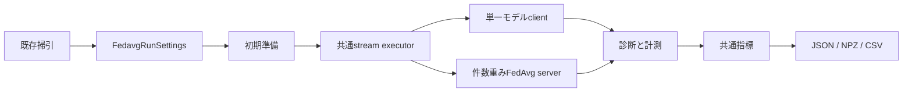

# Design Document

## Overview
構成名はfedavg、公開型は既存Feddriftと同じ単語規則のFedavg。実験内での意味は「単一モデル、全到着データ保持、オンライン学習、データ件数重みFedAvg」。一般的FedAvgの全変種への対応は主張しない。旧Obliviousは対照testでのみ言及する。

## Boundary Commitments
### This Spec Owns
FedAvg固有のclient/server、完全設定と初期準備、実行・計測・評価・保存、既存掃引との統合を一つの流れとして所有する。task境界は状態所有と統合責務で分ける。
### Out of Boundary
既存FedSDA/FedDriftの数値変更、LEGACY修正、golden追加/変更、blobs、旧alias、共通実行契約の変更。
### Allowed Dependencies
methods/fedavgは共通モデル/学習/損失統計/記録だけへ依存し、runtime/CLI/保存/旧実装へ依存しない。runtimeは既存データ生成、初期事前学習、独立モデル更新、共通stream executor、計測hook、評価計算を組み立てる。依存境界testはmoduleごとのexact許可集合を登録する。
### Revalidation Triggers
モデル構造、optimizer生成/複製、stream順、型付き設定のシリアライズ、計測hook、保存列が変わったときは旧全体run対照・掃引ID・freshを再検証する。

## Architecture

新依存は追加しない。共通executorの候補関連操作はFedAvgでは明示的no-op/false adapterとする。共通の正常/失敗進行は既存検証を再利用する。

## File Structure Plan
`src/federated_learning_experiments/`配下:
- methods/fedavg/__init__.py、fedavg_client.py: 単一clientのモデル/optimizer、全保持データ、予測・損失・更新件数、保留更新。
- runtime/fedavg_run_settings.py: 凍結の参加者設定と完全run設定、既定設定生成。
- runtime/fedavg_run_server.py: global parameter・集約統計・通信・集約演算、配布によるclient再生成。
- runtime/fedavg_run_participant_factory.py: 事前学習、同時deepcopy、client/server組立て。成功した参加者だけ公開。
- runtime/fedavg_experiment_run.py: 共通executorへの接続、準備/ラウンド/終端計数、共通指標導出。
- runtime/fedavg_run_record_tables.py: 可変記録の対応検査と表変換。
- runtime/fedavg_run_artifact_files.py: FedDriftと同形の原子的2ファイル保存/安全読込、method_name=fedavg。
変更: sweep/experiment_configurations.py、experiment_sweep_plan.py、experiment_sweep_execution.py（型unionとdispatch、既存ID維持）、commandのhelp、docs/experiments/experiment-sweep.md、共用freshと依存境界、resume。
対照testはtests/refactoring/test_fedavg_experiment_run.py、test_fedavg_experiment_sweep.py。

## Components and Interfaces
### 設定
FedavgRunParticipantSettings: initial_model_pretraining_settings、hidden_layer_widths、parameter_optimizer_settings、local_training_batch_sample_count、updates_per_sample、local_update_interval_per_client_samples。exact型、正の幅/batch/間隔、非負予算を事前検査。seed上限などは既存StreamProtocolExecutionSettingsで検査。既定値は旧と同じ: 500標本/10epoch/batch32、合成(32,32)/lr.01、MNIST(1568,)/lr.001、Adam AMSGrad wd.001、client batch32/update1/間隔1、概念gap300/p.0015、評価delay100/recovery200。
FedavgRunSettings: execution_settings、run_participant_settings、run_metric_settings。実行入口で再検査。
### Client
モデル/optimizerは初期事前学習の2参照を一度にdeepcopyし、結び付きを保つ。モデルIDは常に0。ObservedSample→float32の1行特徴と1列ラベル。到着位置連続、非負builtin概念ID、寸法とクラス範囲・有限を最初に検査。予測は閾値0.5/argmax、損失は既存bounded loss。全体Welfordへだけ追加（旧はオンラインclass統計を更新しない）。初期class統計は維持。真の概念は記録専用、旧にない概念割当診断を判断へ使わない。
保持標本は到着順。pendingを1増やし、更新間隔へ達すればpending×updates回、十分なbatchがあるときだけRandom.sample→既存独立モデル更新。区間末も同じ消化。足りない場合もpendingは0へ戻る。同期は新分類器をclient順に生成（CPU Torch RNG消費を維持）、parameter snapshotをload、optimizerを新規生成、保持データ/統計/件数は保持する。
FedavgClient.apply_global_parameters(*, parameter_snapshot: dict[str, Tensor]) -> Noneはserver専用の配布入口。FedavgRunServer.synchronize_modelsが集約後client順に呼ぶ。共通executorはこの操作を直接呼ばず、RunServerOperations.synchronize_modelsを呼ぶだけ。受理するsnapshotは現clientと同じキー/shape/dtype/deviceの有限CPU float32値とし、検査後に新分類器とoptimizerを構築して交換する。公開するのは実際のserver→client接続境界であり、候補登録契約の一部ではない。

### Server
各clientの保持件数>0のモデルだけを回収。最初のsnapshot×件数、以後snapshot×件数を順次加算、最後にtotal件数で除算。統計はclientの全体mean×nをclient順に加算し、nの合計で除算、M2=0。clientの自身の統計を配布統計で上書きしない。全clientへ1モデル配布、軽量message0。初期配布は数えない。集約MACは参加client×parameter値数（既存定義）、正規化分母は処理件数＝保有モデル×標本件数。
### Factory / execution / measurement
概念0事前学習を既存関数で実施。factoryは借りたRandom/RandomStateとdataset生成器を検査。execute_stream_protocol_runをそのまま利用し、準備とserverの同期前/後を計測する薄い内部wrapperで、準備、本実行、round、終端を分離。失敗は既存RunExecutionErrorの位置/cause。prepared参照は直前の成功分だけ。
### Metrics / artifacts
FedavgRunMetricsは共通基本指標、通信snapshot、model/server counts、computation summary、最終parameter値/byte数。切替は空tupleを共通検出計算へ渡す。存在しないrouting/candidate/clustering指標を作らない。記録表はsample_predictionの位置/ID0/正誤/予測・真クラス/概念、全生成概念と変更、保有数1、syncモデル数1、通信差分、round計算、model統計/学習件数、run生成/処理/末尾件数、実行イベント。ゼロ処理時もclient×0 shapeを維持。
保存はformat1、method_name=fedavg、有限JSON/null、既存FedDriftと同じパス検査・UUID一時名・NPZ先/JSON後renameと失敗cleanup。loadは他手法/不正version/別directoryファイル名を拒否。settings辞書とarraysを返し型復元を行わない。
掃引は正式名fedavgのみ追加。共通軸のみ適用、FedDrift閾値軸はFedDriftのみ。ID計算の既存形式/既存条件のhashは変更しない。出力はfedavg/runs、既存再開とspawn制御を利用する。

## Requirements Traceability
| IDs | Components |
| --- | --- |
| 1.1, 1.2, 1.4, 2.3 | Client |
| 1.3, 1.4 | Server |
| 2.1, 2.2 | Settings, Factory, execution |
| 3.1, 3.2 | metrics, measurement |
| 3.3 | record tables, artifact files |
| 4.1 | sweep integration |
| 4.2 | real legacy comparison, regression, fresh |

## Testing Strategy
実旧setup/ObliviousClient/BaseServer/_run_per_sample_timestepを直接oracleとして、縮小寸法の6dataset、Adam/SGD、batch不足、更新0/複数、更新間隔と同期間隔の非整除、同期0/複数、余り末尾で比較する。parameter名はtest側で対応付け、optimizer値/状態・統計・データ・予測/ドリフト列・通信・Torch/Python/NumPyを照合。変更概念を入れ替えた対照で学習不干渉。保存roundtripと片方存在/不正名/stale要約拒否、混合掃引/parallel再開/print-plan読取専用/CSVを確認。既存依存境界、fresh、新旧golden、全pytest、品質、WSL対象対照を最後に実測する。
