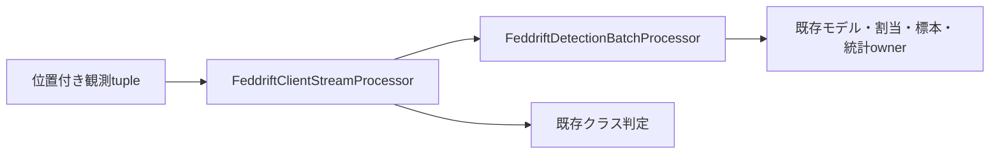

# Design Document

## Overview
`FeddriftClientStreamProcessor`は一clientの観測数・検出待ち標本・予測記録・完了バッチ結果を所有する。既存`FeddriftDetectionBatchProcessor`を借用し、同じownerに対する予測と割当を接続する。全clientやrunの組立ではない。

## Boundary Commitments
- 観測列を新しいruntime moduleへ置く。バッチ判定・登録・評価抽出の状態は前specの部品へ委譲する。
- 局所学習要求を発行しない。旧experimentのprocess_batch→prepare_timestep→R回local_train/server roundの別タイミングは後続specで接続する。
- 旧の1D入力補正とzipの黙示的切捨ては再現せず、供給側が正規化した`IndexedObservedTrainingSample`のexact tupleを要求する。位置は0から連続、概念IDはint（負も許す）またはNone、bool拒否。
- 公開名と役割はnaming.md。命名承認は最終独立レビュー。

## Architecture

## Components and Interfaces
- バッチ部品に`current_training_model_state`（借用した現在の保有記録）と`validate_detection_batch_inputs`（forwardも更新もせず検査）を追加する。streamへregistry/assignmentを重複注入せず、予測と検出のowner同一性を構造で保証する。保有記録はmutableモデルの借用であり、deepcopyしない。
- streamのconstructor: exactバッチ部品と正のbuiltin intの検出件数。モデルの実検査は観測・flush直前に行う。
- `process_observations(indexed_observations=...) -> bool`: exact型/連続位置/概念型を全件検査し、既存validatorでpending+入力の全標本とモデルを検査してからforwardする。空tupleは検査済みownerへのアクセスなしのno-op。
- 各標本はno_gradで現在のclassifierをforwardし、既存`predict_class_labels_from_prediction_scores`で二値の厳密>0.5、多クラス最小番号argmaxを得る。不変`FeddriftSamplePrediction`を構築した後にcount/バッファを足す。満杯ならバッチ処理し結果を予測記録へ付け、バッファを空にする。
- `flush_detection_buffer() -> transition | None`: 残りの全検査をして既存バッチ処理へ渡し、完了結果へ足して空にする。予測記録へは足さない・書き換えない。
- snapshot propertyはtuple（bufferのTensorは旧同様借用）、countはint。完了結果のadaptation_kindがnew_model_createdなら検出先頭と切替末尾、held_model_selectedなら切替末尾だけを参照できる。
- 予測記録constructorは型・位置・クラス非負・正否対応・transition末尾対応を検査する。作成は更新前、検出後の結果の付加は検証済み実部品の値に限る。

## State and Error Handling
設定/入力/現在モデルの構造やTensor不正は全ブロックのforward前に拒否する。部品の実処理中の例外・一時ID衝突・外側からの同時変更について、全ブロックのrollbackは保証しない。処理は同期的な単一ownerで、外側は呼出し中に共有状態や借用Tensorを変更しない。失敗した検出のbufferは保ち、完了結果へは追加しない。

## Requirements Traceability
| 要求 | 対応 |
| --- | --- |
| 1.1–1.3 | 現在モデル予測・不変記録・no_grad・実旧対照 |
| 2.1–2.3 | 件数/バッファ・bool・結果保持・複数ブロック対照 |
| 3.1 | 部分flush・繰返しflush・旧記録維持対照 |
| 3.2 | 全件事前検査・forward spy・owner/RNG保持test |
| 3.3 | exact依存境界・fresh process smoke |

## Testing Strategy
旧FedDriftClientの実process_batch/flushと、前specのtest用同一モデルownerを使う。二値/多クラス、検出件数1/3/5、複数時刻・複数発火・既存切替・新規生成・部分flushを比較する。predictionの各field、完了結果に対応する旧検出/切替位置、全owner、Python/Torch乱数・既存参照/optimizer stateを照合する。新実装だけのfresh smoke、全pytest、Ruff、Pyright、pip check。fixed/0epochのみでearly_stopping構成は追加しない。
