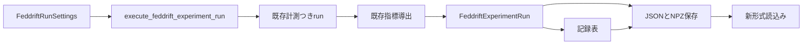

# Design Document

## Overview

FedDriftの単一runの公開入口と保存形式を接続する。既存の計測・指標を変更せず、FedSDAと同じJSON要約＋NPZ記録表の構成を用いる。手法識別は`method_name: feddrift`。FedSDAの旧形式との互換を追加しない。

## Boundary Commitments

### This Spec Owns
- 完全なrun設定、実験runの戻り値、記録表と新成果物の保存・読込み。
### Out of Boundary
- CLI・掃引・preset、新規診断の導出、既存FedSDAの保存コードの再編、旧出力・goldenの更新。
### Allowed Dependencies
- 既存FedDrift実行・参加者・指標・記録owner、共通設定serializer、NumPyと標準ライブラリ。新依存なし。新コードから旧実装/testをimportしない。
### Revalidation Triggers
- 設定の形・列の意味・指標の形を変更したら保存・読込みと後続CLIを再検証する。形式の版は1から始め、契約変更時に上げる。

## Architecture

## File Structure Plan

新規sourceは全て`src/federated_learning_experiments/runtime/`。

| ファイル | 責務 |
|---|---|
| `feddrift_run_settings.py` | 完全な条件の不変の束と、実行前の型/値/組合せ検証 |
| `feddrift_experiment_run.py` | 既存計測run→指標の公開入口と結果 |
| `feddrift_run_record_tables.py` | 結果から名前付きの数値/文字列配列を作る |
| `feddrift_run_artifact_files.py` | 新JSON/NPZの保存・読込み |

変更: `tests/refactoring/test_single_run_dependency_boundaries.py`（実際のimportの許可）、`tests/refactoring/fresh_process_smoke.py`（実行/保存/読込み経路）。新testは`tests/refactoring/test_feddrift_experiment_run_artifacts.py`。一時検証証拠は既存venv配下、specは標準6文書。

## Requirements Traceability

| 要求 | 対応 |
|---|---|
| 1.1, 1.2 | 完全設定のexact型と部分設定の再検証、集約間隔=検出バッチ |
| 1.3, 1.4 | 既存計測run→既存指標の接続、実旧と既存run照合 |
| 2.1, 2.2, 2.3, 2.4 | 記録表builder、空系列/順序/欠測のtest |
| 3.1, 3.2, 3.3, 3.4 | saver、事前検査、失敗注入とroundtrip |
| 4.1, 4.2, 4.3 | loader、不正ファイル拒否、freshと既存回帰 |

## Components and Interfaces

### 完全設定と実行

`FeddriftRunSettings`はfrozen/kw_only。`execution_settings: FeddriftStreamProtocolExecutionSettings`、`run_participant_settings: FeddriftRunParticipantSettings`、`run_metric_settings: RunMetricSettings`を持つ。exact型→全部分の再検査→集約間隔対応の順。実行入口でも再検査する。presetは作らず、利用者は既存部分設定を束ねる。

`execute_feddrift_experiment_run(*, run_settings) -> FeddriftExperimentRun`。結果は条件、`FeddriftMeasuredRun`、`FeddriftRunMetrics`を持つfrozen/eq=False型。実行・評価の式を複製せず、既存関数をそのまま呼ぶ。

### 記録表

`build_feddrift_run_record_tables(*, experiment_run) -> dict[str, ndarray]`。キーは`表.列`。整数int64、真偽bool、float64、文字列Unicode。欠測の非負整数/真偽の診断は−1、欠測距離はNaN。実在する負のモデルIDはそのまま保存する。標本表はclient×処理済標本（未処理末尾を含めない）。事象表はclient順・記録順の一次元。モデル登録/クラスタ/クロス評価はowner順、終了時学習量はclient順・保有順。

| 表 | 内容/形 |
|---|---|
| `sample_prediction` | sample_index、prediction_model_id、predicted_class_id、observed_class_id、observed_concept_id、prediction_is_correct、held_model_count_at_prediction（client×標本） |
| `concept_change` | client_id、first_new_concept_sample_index（実行結果の評価概念列全体から抽出） |
| `training_model_switch` | client_id、switch_sample_index（clientの記録、統合による付替とは区別） |
| `detection_batch` | client_idと既存transitionの全field（全体runでは通常バッチのみ。生成末尾は未処理） |
| `adaptation` | client_idと既存適応recordの全field（candidateの行は生成しない） |
| `model_registration` | model_id、registered_server_timestep_index（初期は−1）、registering_client_id（初期は−1）、is_final_global_model |
| `model_clustering`, `model_pair_clustering` | 既存全field。round_indexはserver_timestep_index（既存ownerが通常時刻を格納するfield） |
| `client_cross_evaluation`, `client_cross_evaluation_class` | 既存全fieldの列（round_indexはserver_timestep_index）。正誤未計測は−1、クラス行なしなら空列 |
| `client_held_model` | model診断の終了時学習量の全field |
| `server_timestep` | timestep_index、通常同期後モデル数、client保有数（時刻×client）、標本処理/同期の全ModelComputationCounts field |
| `preparation_model_computation`, `finalization_model_computation` | 全ModelComputationCounts field、各1行 |

正常runのsnapshotを入力とし、exact実験run/設定/計測結果/指標と既存の導出検査を用いて主要な対応を確かめる。再導出した全指標と保存要約の指標を非有限値の正規化後に照合し、不一致を保存前に拒否する。表化は読取りのみ。計数の列順は既存dataclass宣言順。記録表に新しい判断を持ち込まない。

### 保存と読込み

`save_feddrift_experiment_run(*, experiment_run, output_directory: Path, file_stem: str) -> FeddriftRunArtifactPaths`。既存FedSDAと同じ保存フロー（ディレクトリは作らない、既存出力の片方でも拒否、全内容を先に生成、一時ファイルへ書く、NPZ→JSONの順で配置、例外では作成物を掃除）。並行して同じfile_stemへ書く契約はない。要約はformat_version=1、method_name=feddrift、run_settings、run_metrics、environment、record_table_file_name。JSONの非有限はnull、NPZはallow_pickle=Falseで読めるdtype。

`load_feddrift_run_artifacts(*, summary_file_path: Path) -> tuple[dict[str, object], dict[str, ndarray]]`。要約のexact builtin版/手法、表名を確認してから読み込む。表名は空/`.`/`..`/両OSの区切り/コロンを拒否し、`.npz`だけ。同ディレクトリ外へ辿らない。型の復元や旧形式読込みはしない。条件/指標/環境の必須性と型の検査も行わず、分析用の辞書として返す。

## Testing Strategy

- 完全設定の不正型/値/バッチ対応をモデル生成前に拒否。既存部分設定をfrozen回避で壊したケースを含む。
- 実旧全体入口と既存の計測入口をoracleとして、基本指標・予測/切替/登録/クロス評価/クラスタの表と数値、終了状態/RNGを照合。sine2/sea4/mnist2、生成端数、通常同期なしを含む。旧メソッドの式をtestへ複製しない。
- 表の全列とdtype/形/行順、unknown/None/空列、非有限JSON、既存ファイル拒否、保存各段の失敗掃除、loaderの経路拒否とroundtripを検証。
- fresh新経路、依存境界、Ruff/Pyright、既存Linux golden、全pytest/固定旧回帰を既存手順で行う。
