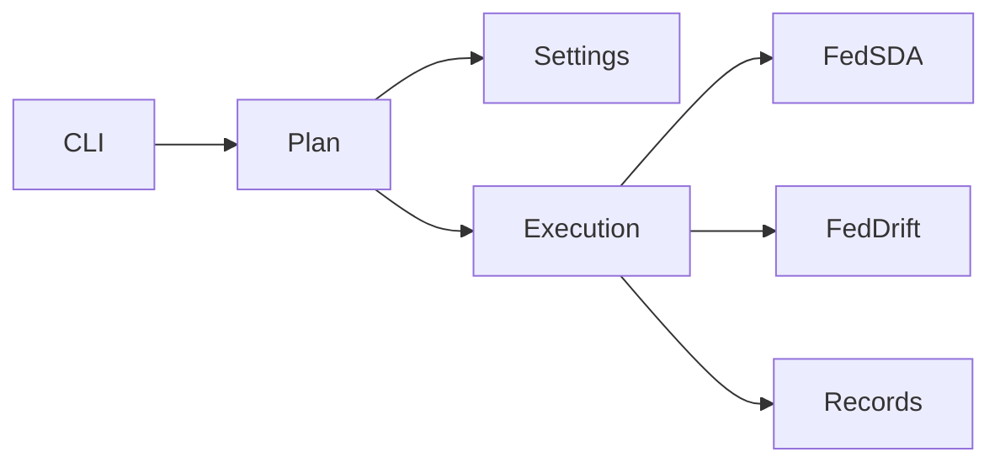

# Design Document

## Overview
FedDriftを既存のsweep入口へ追加する。単一run・成果物の実装を再利用し、数値計算や保存形式は変えない。
### Goals / Non-Goals
既定条件から掃引・再開・CSVまで接続する。対応datasetはsine2・sea2・sea4・circle2・mnist2・mnist4。blobsは新実装の既存対象外を維持。新しい汎用手法registry、旧alias、任意設定CLI、golden作成は導入しない。

## Boundary Commitments
### This Spec Owns
- FedDriftの既定設定builder、既存計画の型の拡張、専用閾値軸、手法別の実行/保存/読込みの選択。
- CLIの専用軸とCSVのFedDrift条件列。
### Out of Boundary
- run内部の数値/RNG/時刻進行、指標、JSON/NPZ形式、既存FedSDAの既定設定。
### Allowed Dependencies
- sweep→runtimeのFedSDA/FedDrift完全設定と実行/成果物API、既存configuration/core/data/evaluation/learning設定型。
- runtime→機能設定型。runtimeはsweepや旧実装へ依存しない。新規依存は既存exact境界検査へ登録する。
### Revalidation Triggers
- 設定unionと分岐の変更でFedSDA sweepと全構成の選択testを再確認。
- 専用軸追加でrun hash・順序・再開・CSV・spawn worker・freshの対応を再確認。

## Architecture

既存のspawn ProcessPoolExecutorとrun単位の結果処理を維持。計画は全条件を出力作成より先に検証する。手法の選択は完全設定のexact型による2分岐に限定する。

## File Structure Plan
新規runtime/feddrift_default_run_settings.pyは既定完全設定を作る。以下のパスはsrc/federated_learning_experiments/配下。
- sweep/experiment_configurations.py: feddrift登録とbuilder接続。
- sweep/experiment_sweep_plan.py: 完全設定union・閾値軸・計画順序とhash。
- sweep/experiment_sweep_execution.py: exact設定型によるrun/保存/loader選択。
- sweep/experiment_sweep_command.py: --feddrift-loss-increase-thresholds。
- sweep/experiment_sweep_records.py: FedDrift条件のCSV列。
- tests/refactoring/test_feddrift_experiment_sweep.py: 新しい既定・軸・実run/CLI/再開/spawn。
- tests/refactoring/test_experiment_sweep.py: 計画記録の新軸Noneに期待値を対応。
- tests/refactoring/test_fedsda_configuration_variants.py: 手法追加に対応する選択肢照合のみ。
- tests/refactoring/test_single_run_dependency_boundaries.py、fresh_process_smoke.py: 新依存と新経路。
- docs/experiments/experiment-sweep.md: 利用方法。

## Components and Interfaces
### 1. 既定完全設定
build_default_feddrift_run_settings(experiment_run_conditions, loss_increase_threshold=0.1)→FeddriftRunSettings。
条件はexact型・再検証。間隔=検出バッチ。合成幅(32,32)/学習率0.01、MNIST幅(1568,)/0.001。Adam AMSGrad/weight_decay0.001、事前学習500/10/32、学習batch32/updates1、評価保持50/追加20/依頼50、最大client3/最小標本5、complete/隔離1/R1。事前学習重み500、client/server閾値を同じ指定値へ。概念変更gap300/probability0.0015、指標delay100/recovery200。旧configをsourceから読まない。

### 2. 条件展開
build_experiment_run_settingsとPlannedExperimentRun.run_settings、make_run_identifierはFedsdaRunSettings | FeddriftRunSettingsへ拡張。新しいbuilder引数はFedDriftの専用builderに置く。
ExperimentSweepPlan.feddrift_loss_increase_thresholds: tuple[float,...] | None = None。Noneはfeddriftでだけ(0.1,)へ解決。明示tupleは非空・builtin float・有限・非負・distinct、feddrift選択必須。
構成→dataset→間隔→seed→閾値（FedSDAは閾値ループなし）。FedDriftはbuilderの完全設定をclient/server両方の閾値を同時に置換して使う。hash入力は既存の構成名＋完全設定のcanonical JSONのまま。FedSDAの既定hash不変。閾値は読める識別子部分に追加せずhashで区別する。

### 3. 実行と記録
実行/保存はexact FeddriftRunSettingsなら既存FedDrift API、exact FedsdaRunSettingsなら既存FedSDA API。未知型は実行開始前に拒否。再開は同じ分岐のloaderで手法・版・表を検査し、完全設定の辞書を照合する。既存の片方だけ/破損/不一致をfailedとする境界を維持する。
CSVはFedDrift要約のrun_client_settingsからdetection_batch_sample_countとloss_increase_thresholdを追加。既存FedSDA CSV列は変えない。掃引記録はasdict(plan)により軸も保存。その他の完全条件は既存run JSONが正本。

## Requirements Traceability
| 要求 | 接続先 |
| --- | --- |
| 1.1, 1.2, 1.3 | 既定builder・configuration・条件検証 |
| 2.1, 2.2, 2.3, 2.4 | Plan・hash |
| 3.1, 3.2 | Execution・既存artifacts |
| 3.3 | Records・既存metrics |
| 4.1, 4.2 | Command・利用文書 |
| 4.3 | fresh・依存境界・全回帰 |

## Error Handling
専用軸の不正値は計画のTypeError/ValueError→CLI2。run例外は既存failed→CLI1。成功/既存skipはCLI0。MNIST未配置は実行前CLI2。print-planはMNISTの読込みも出力作成も行わない。

## Testing Strategy
- 既定を全6datasetで実旧configの値と照合、旧設定を変えても新設定へ漏れないこととRNG不変を確認。
- mixed計画の件数/順序/client-server閾値/hash、FedSDA固定識別子、不正軸の拒否。
- 実FedDriftの逐次/spawn保存を単一run APIと完全設定・全指標・全表の値で照合（環境・時間・保存先・実行状態は除外）。再開skip、wrong method/settings/partial/corruptの拒否。
- CLI実行→CSV/記録→再開、help/不正引数/print-plan出力なし。既存FedSDA sweepと構成照合を再実行。
- 依存境界、fresh、全pytest、Ruff/Pyright、既存Linux golden。変異は既定では行わない。
