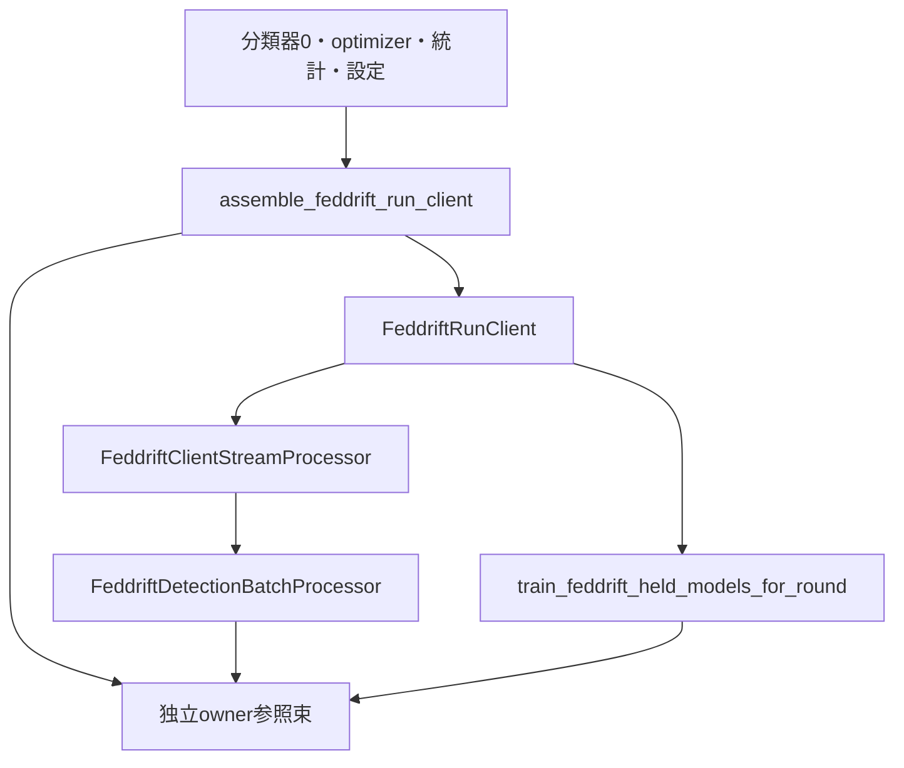

# Design Document

## Overview
初期モデル0の分類器とoptimizer管理器を一緒にdeepcopyし、状態ownerを生成して既存FedDrift部品へ渡す。一clientの入口は観測ブロック・一round学習・登録可否・終端flushを持つ。FedSDAの5操作のProtocolは、その実行順が異なるため実装しない。

## Boundary Commitments
### This Spec Owns
- `FeddriftRunClientSettings`の検査と、一clientの組立および部品への操作委譲。
- frozenなowner参照束。可変状態の正本は既存owner/processorにだけ置く。
### Out of Boundary
初期事前学習、全参加者factory、サーバ連携/同期、全体進行、演算/時間計測、旧/golden変更。初期モデルは0だけを組み立て、任意の初期モデル集合を受ける互換窓口は作らない。
### Allowed Dependencies
runtime→既存FedDrift processor/round処理、学習owner・optimizer/parameter検査、損失統計、評価標本、送信状態、観測標本。標準dataclass/deepcopy/Random/mathとtorchの標本変換を使う。旧/config/test/CLIへの依存は禁止。
### Revalidation Triggers
owner接続、初期optimizer複写、観測入力の形、round倍率、残余flush、processor契約が変わればclient対照とfresh接続を再検証する。

## Architecture

初期classifier/optimizerは同じdeepcopyのmemoで写し、写しのoptimizerが写しのparameterを指す。統計は既存storeが検査して写す。Randomはrunの乱数列として借用し、組立で消費しない。複数clientで同じRandomを使えば旧の全client共通Python RNGと同じ順序になる。

## Components and Interface Contracts
### Settings
frozen kw_onlyの`FeddriftRunClientSettings`に損失閾値、検出/学習batch件数、更新倍率、評価保持/追加件数、新規optimizer設定を明示する。件数はbuiltin int、閾値はbuiltin float。exact SGD/Adam設定を再検査する。完成run設定での正式な置き場所は後続へ引き継ぐ。

### Assembly
`assemble_feddrift_run_client(client_id, initial_classifier, initial_parameter_optimizer_state, initial_loss_statistics, run_client_settings, python_random_generator)`。
全検査をコピー/owner生成より前に行う。builtin非負client ID、exact型、設定の再検査、独立構造の実検査・有限CPU float32 parameter・requires_gradとoptimizer参照順、損失統計とクラス範囲を確かめる。構造/parameter検査は既存private helperを再利用し、forward/backward/zero_gradや乱数を実行しない。grad contextの有効/無効に依存しない。
成功後はclassifier/optimizerを同時に写し、モデル0をregistryへ登録する。統計store、学習/評価store、割当0、ID allocator、送信状態、学習計数を作り、同じ参照でbatch/stream/roundを接続する。値・mode・optimizer状態を引き継ぎ、parameterの初期gradは実旧deepcopy同様Noneになる。client constructorはassembly専用の借用参照保持である。

### Client Operations
- `process_observed_block(observed_samples, evaluation_concept_ids)`はexact tuple、同じ長さ、exact ObservedSampleの再検査、概念builtin int/Noneを検査し、CPU float32一行Tensorへ変換する。全標本を連続indexの既存IndexedObservedTrainingSampleへ変換してからstreamへ一括委譲する。shape/finite/label検査はstreamが全列に実施する。
- `train_local_round()`は設定の検出batch件数をk_stepsとしてround関数へ渡し、loss tupleを返す。観測やflushから学習を呼ばない。
- `flush_detection_buffer()`はstreamへ委譲してtransition/Noneを返す。
- `has_model_ready_for_server_registration()`はpending uploadのready値を読む。
- readonly propertyはclient ID、owner束、batch processor、stream processorの借用参照。ownerや結果を別の状態へ写して保持しない。

## Requirements Traceability
| 要求 | 接続と検証 |
|---|---|
| 1.1, 1.2, 1.3 | assembly・owner束、実旧__init__、複数client/非干渉と拒否 |
| 2.1 | settings、境界値/改変設定の拒否 |
| 3.1, 3.3, 3.4 | block変換→stream→batch、実旧process_batch/flush、概念だけの変化 |
| 3.2 | 同じregistry/store/Random→round、実旧local_trainとoptimizer状態 |
| 3.5 | 同じpending uploadのreadiness、乱数不変 |
| 4.1 | exact依存検査・共用fresh script |

## File Structure Plan
| パス | 操作・責務 |
|---|---|
| `src/federated_learning_experiments/runtime/feddrift_run_client_settings.py` | 新規、client条件と検査 |
| `src/federated_learning_experiments/runtime/feddrift_run_client.py` | 新規、組立と操作委譲 |
| `tests/refactoring/test_feddrift_run_client.py` | 新規、実旧対照と入力/共有参照拒否 |
| `tests/refactoring/test_single_run_dependency_boundaries.py` | 変更、2moduleのexact許可と外側依存拒否 |
| `tests/refactoring/fresh_process_smoke.py` | 変更、新clientの組立から実学習まで接続 |

## Error Handling and Differences from Legacy
旧はzipの短い側だけ処理するが、新は長さ不一致/不正後続標本を最初の更新前に拒否する。初期構造・optimizer・統計は先に拒否し、copyで不正参照を延命しない。通常経路の数値/順序は変えない。processor実行中の外部例外への全block rollbackと、借用ownerの同時変更は契約外。

## Testing Strategy
settings/assemblyはstubへ拒否・実旧__init__対照を先に書く。SGDと学習済みAdam、2/4クラス、no_grad下の生成、複数clientのparameter/grad/optimizer/store分離と3RNG不変を確認する。流れは実旧process_batch→複数local_train→flushを実行し、model/統計/store/記録/計数/optimizer/RNGを各段で対応付ける。満杯・またぎ・残余・新規モデル分岐、空block、ready、概念の不干渉、後続不正標本を検証する。最後にfresh/依存・Ruff/Pyright/pip・独立レビュー・全pytest/JUnitを照合する。
