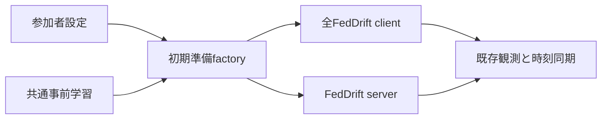

# Design Document

## Overview
runtimeのFedDrift参加者factoryを追加する。全体runへの接続の前提となる初期準備の流れ全体を移植し、返した参加者の観測・同期までを接続検証する。

## Boundary Commitments
### This Spec Owns
設定の束、設定間の整合、入力を副作用前に検査するfactory、直前の参加者集合への参照。可変状態は既存ownerに残す。
### Out of Boundary
既存RunParticipantsのFedSDA用操作契約へFedDriftを偽装しない。全体run・終端・サーバ精度・保存・指標・CLIを追加しない。
### Allowed Dependencies
runtimeの既存pretrain/client/server、dataset定義/標本生成契約、run条件/乱数源、既存学習設定/モデルsnapshot。標準dataclasses/randomとNumPy RandomStateを使う。旧・test・保存・sweepは依存禁止。
### Revalidation Triggers
初期学習の戻り値、client/server組立て契約、共有Random、初期ID/parameter名/optimizer構造の変更時は当factoryと観測・同期対照を再検証する。

## Architecture

FedSDAのfactoryと同じ準備順序を再利用するが、観測/syncの契約が異なるため専用の参加者集合を返す。動作しないProtocol castや後方互換窓口は置かない。

## File Structure Plan
- 新規 `src/federated_learning_experiments/runtime/feddrift_run_participant_factory.py`: 設定・参加者集合と初期準備。
- 新規 `tests/refactoring/test_feddrift_run_participant_factory.py`: 実旧_setup_server_and_clientsとの対照と拒否・再準備・同期接続。
- 変更 `tests/refactoring/test_single_run_dependency_boundaries.py`: 新moduleのexact依存許可と禁止依存例。
- 変更 `tests/refactoring/fresh_process_smoke.py`: 新factoryから観測/同期する既存smokeへ置換。

## Components & Interfaces
### FeddriftRunParticipantSettings（1.1、2.1）
frozen kw-only。client設定、server設定、初期学習設定、隠れ層幅tupleを保持しexact型と各__post_init__を再検査。独立モデル構造は固定。正のbuiltin intの非空幅tuple。初期server重みは事前学習標本数、client検出閾値はserver距離閾値と同値に限定する（旧の同一設定）。初期optimizerはserverのrebuilt設定、新規optimizerはclient設定を使い分ける。
### FeddriftRunParticipants（1.2、3.1）
全clientのtupleとserverへの参照を固定する。空でないexact client tuple/昇順連続client IDと、serverが同じtupleを参照することを検査。可変状態を重複所有しない。
### FeddriftRunParticipantFactory（1.1〜3.1）
validate_configurationは設定だけ再検査。prepare_runはexact ExperimentRunConditionsの再検査、exact RunRandomSourcesとPython Random/NumPy RandomState、datasetとexact generatorの対応、generatorが同じrunのNumPy源を借用すること、集約間隔が検出バッチ件数に等しいことを副作用前に検査する。既存pretrainが勾配無効とgenerator不正を生成前に検査する。
pretrain（independent構造・dataset寸法・server rebuilt optimizer）→client 0..N-1の組立て（deepcopy）→server（初期snapshot/統計）→集合生成→prepared_run_participants更新。失敗時は直前の成功集合を保持する。実行時エラーの乱数rollbackはしない（入力拒否契約と区別）。seedの設定は呼出元、factoryはtorchをseedしない。

## Testing Strategy
実旧SimpleMLPを使うModeSpecと_setup_server_and_clientsを実行する。設定はtest側で明示対応し、実旧の事前学習を複製しない。二値/多クラスdataset、SGD/Adam、epoch 0/正、client複数を比較する。全model/optimizer/統計/owner/server記録/3乱数、共有Randomと可変状態分離を確認する。factory入力拒否・成功後の拒否・二度目の成功を検証し、既存実旧対照helperで観測と同期後の全状態を比較する。exact依存・fresh、新旧回帰を含む全pytestと品質検査を最終ゲートとする。
