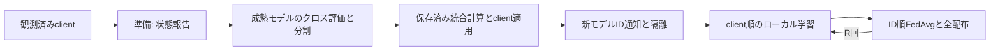

# Design Document

## Overview / Boundary Commitments

通常FedDriftのprepare_timestepと、その後のR回のlocal_train→FedAvg→broadcastを移植する。サーバは観測済みのFeddriftRunClient列を借りる。初期parameter/統計・設定からserverを作るが、データ/初期事前学習/全clientのfactoryは後続。FedSDAの実行Protocolを装わない。

## Components and Interfaces

| 部品 | 責務 |
| --- | --- |
| runtime/feddrift_model_distribution_application.py | 全入力検査と再構築の準備、client ownerへ統計→評価→学習→計数→registry→現在IDを適用 |
| runtime/feddrift_run_client.py | 適応記録ownerを追加し、配布適用と借用Random/保持IDを公開。既存観測/学習を変更しない |
| methods/feddrift/loss_distance_model_clustering.py | 4損失の件数/平均から距離を作り、complete/average/connectedで決定的に分割 |
| runtime/feddrift_server_settings.py | 距離、linkage、評価上限/最低件数、隔離期間、R、初期重み、再構築optimizer設定 |
| runtime/feddrift_run_server.py | 初期repository、歴史的重み/隔離期限の唯一のowner。準備・登録・FedAvg・全配布・R回接続と記録 |

公開操作はFeddriftRunServer.prepare_timestep、aggregate_and_distribute_training_round、synchronize_timestep。前者2つは旧の操作との対照にも使い、synchronize_timestepが準備→R回のclient順train_local_round→集約配布へ接続する。Rの値は正builtin int。全設定をconstructorと操作入口で再検証する。

GlobalModelRepository、CommunicationVolumeRecordStore、CrossEvaluationRecordStore、ModelClusteringRecordStoreを利用する。repositoryの登録来歴/採番と、parameterが初めて上がるまでの隔離状態を分ける（ID通知だけではparameterを置かない）。サーバの歴史的重み/期限はprivate dictで、snapshotはコピーして返す。

配布入力は非空builtin dict、非負builtin ID、snapshotは独立モデルreferenceと同じキー/shape、CPU float32 strided/非nested/有限。対応はbuiltin int→intで、元は保有正式ID、行先は配布ID。一時IDには対応をかけない。現行IDが結果の正式IDまたは保持一時IDにあることを確認する。optimizerはexact Adam/Sgd設定を再検証。統計の選択は完了済みselect_loss_statistics_after_model_id_mappingへ接続し、frozen field破損も拒否。全ownerはexact型。設定や外部snapshotによる例外はmodel生成/更新/RNGより前。メモリ不足やTorch実行の例外までtransactionalな巻戻しは約束しない。

## Execution Flow

成熟はsorted global IDsでt>=期限（欠落0）。候補/対象/保持者順のクロス評価は汎用evaluate_candidate_model_on_target_model_samplesを使う。旧はモデル転送なしでもcandidateをserver parameterで作り直すため、手元モデル評価へ置換しない。保持者はregistry/損失統計/学習store/現在IDの和。client上限の抽出と標本上限の抽出は同じrunのRandomを借りる。通常旧serverは相補性診断なしなのでcorrectnessを要求しない。評価の和/二乗和はclient helperのfloat32 NumPy sum、server合算はclient順の逐次+=。

距離は候補iの対象jでの平均−iの自己平均と、その逆のmax。4件数が最低値を満たす対だけを使う。linkageは旧cluster_modelsのsorted ID・lexicographic tie-break・群sort・距離欠落なら群対を候補にしない挙動。connectedは閾値以内の辺の連結成分。

群が変わった場合だけcached consolidationへ接続し、未成熟をsorted順の単独群として後ろへ足す。client自身のsnapshotも決定したweightsで平均し、全client入力を検査してから適用する。旧はPythonの評価store抽出→Torchモデル生成、新は生成を更新前へ置くが、2RNGは独立で依存関係がない。実旧と各操作後の3RNG・全ownerが一致することをtestで示す。optimizer設定は旧model_cls()の既定に対応し、新モデル生成用のNEW_MODEL_LRとは別にserver設定で受け取る。

登録はconfirm_held_model_registrationを借り、client順の採番/来歴/現在ID更新/保留解除/期限/通知。FedAvgはID昇順→client順、正の学習store件数をparameterへ掛けて加算後に割る。統計は正の寄与clientのみ、mean*nを逐次加算して割りM2=0。集約0ならparameter/統計/過去重みを保持。配布はrepository挿入順→client順で新モデルを作り、一時モデルは同じrecordを保持。通信は正寄与のupload、全model×全clientのdownload、各parameter値数/element_sizeを計数。

クラスタの対/モデル診断は既存の汎用_make_model_clustering_observationsとparameter相対距離計算を再利用する（FedSDA client型の処理は呼ばない）。概念多数決はcounts ownerから導き判定へ渡さない。クロス評価の基本recordも保存し、集計/保存形式は後続。

## Requirements Traceability

| 要求 | testの境界 |
| --- | --- |
| 1.1–1.3 | 実apply_server_mappingの全owner/optimizer/grad/記録/RNG、入力拒否 |
| 2.1–2.3 | 実prepare_timestep・距離/linkage対照、孤立・評価不足・評価抽出・隔離・統合の連続操作 |
| 2.4 | 即時ready登録、正式ID/来歴/期限/全状態/通信 |
| 3.1–3.3 | 実local_train/run_training_round・R回の連続対照と0寄与 |
| 4.1–4.2 | 型/状態拒否前snapshotとRNG、依存/fresh/全回帰/独立レビュー |

## 旧と違う点 / Non-Goals

契約外の型・非有限snapshot・不整合対応を先に拒否する。正常経路の数値と順序は維持する。基本cross-evaluationの新recordは記録用で判断へ戻さない。通常の実験factoryが使わないcollect_pair_diagnostics=True、サーバ評価/時間指標、終端run_round、全体run/golden/CLIは本specで完成とはしない。
