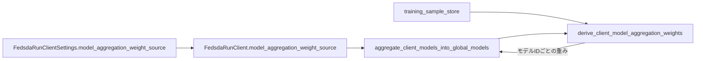

# Design Document

## Overview
**Purpose**: 柔らかい学習の構成`fedsda-soft-training`から、サーバの集約で使う各clientのモデルごとの重み（参加の判定を含む）だけを、固い割り当ての標本の件数に替えた構成`fedsda-soft-training-assignment-count-aggregation-weights`を足す。
**Users**: 1クライアント版の研究で、連合学習でだけ柔らかい学習が固い学習より精度が低い理由を切り分ける研究者。
**Impact**: 既存の構成の挙動・設定の記録・runの識別子は変えない。新しい設定のfieldは既定値を保存しない宣言にし、既存の構成の識別子を保つ。

### Goals
- 局所の処理を`fedsda-soft-training`と同じにしたまま、集約の重みと参加の判定だけを替える。
- 既存の掃引コマンドで実行・保存・一覧・再開でき、既存の固い学習・柔らかい学習の結果と対にできる。

### Non-Goals
- 局所の学習・予測・検出・責任度・統合の変更。固い学習の構成の変更。
- 集約の重みを、学習量と件数の中間にするなどの別の規則。
- uraniumでの本規模の実行と、結果の集計の研究ツール（spec外。主担当が別に行う）。

## Boundary Commitments

### This Spec Owns
- clientの設定の新しいfield（集約の重みの元）と、その検査。
- clientの保有する学習標本の記録から、集約に使うモデルごとの重みを決める関数と、集約からの呼出し。
- 構成名の定数、構成の一覧への登録、構成から設定への組立て。
- 構成の一覧の文書の1行。

### Out of Boundary
- `ModelTrainingSampleStore`・`ResponsibilityWeightedTrainingStore`の保持と更新の規則（読むだけ）。
- 集約の対象のモデル、平均の計算、通信量・パラメータ・統計の反映の順（今のまま）。
- 記録の表・成果物の形式（`fedsda-soft-training`と同じものがそのまま出る）。

### Allowed Dependencies
- `server_model_registration_and_aggregation`は、既にimportしている型と、clientの公開のproperty（新しく足す`model_aggregation_weight_source`）に加えて、新しい関数の引数の型として`learning.training.model_training_sample_store.ModelTrainingSampleStore`だけをimportする（実装時に追加。依存の境界の許可集合へ登録する。runtimeからlearningへの向きで、既存の依存の方向と同じ）。

### Revalidation Triggers
- 柔らかい学習で固い割り当ての標本の保持の規則が変わったとき（件数の意味が変わる）。
- 集約の参加の判定・重みの規則が変わったとき。

## Architecture

### 今の集約の重み（変えない部分の確認）
`aggregate_client_models_into_global_models`は、clientごとに、`training_sample_store.snapshot_ordered_model_training_samples()`の標本の件数を重みにする。ただし、`training_responsibility_provider`と`responsibility_training_store`の両方があるとき（柔らかい学習）は、`responsibility_training_store.training_masses_by_model_id`（責任度の合計）に置き換える。重みが正で、clientが保有するモデルだけが参加し、共有部の重みは参加モデルの重みの合計になる。損失の統計と上りの通信も、参加するモデルだけを数える。

柔らかい学習でも、`append_model_training_samples`は固い割り当ての標本を`_training_samples_by_model_id`へ同じ規則で足し、`reassign`・`remap`も両方に行う（`discard`は製品のどこからも呼ばれない）。よって、固い割り当ての件数は、柔らかい学習のrunでも固い学習と同じ意味の値として読める。

### 変更

1. `FedsdaRunClientSettings`に`model_aggregation_weight_source: str`を足す。
   - 値: `"training_assignment_amounts"`（既定。今の扱い: 柔らかい学習は責任度の合計、固い学習は件数）と`"single_model_assignment_sample_counts"`（常に固い割り当ての件数）。
   - metadata: `omit_default_from_saved_settings=True`、`allowed_parameter_values`に2値。
   - `__post_init__`: 型と値の検査。`"single_model_assignment_sample_counts"`で`training_assignment_strategy != "responsibility_weighted_training"`なら`RunSettingsValidationError`（要求3.2。設定の組立て時なので、runの準備・乱数の消費より前）。
2. `FedsdaRunClient`に読取りだけのproperty`model_aggregation_weight_source`を足す（既存の`prediction_combination_strategy`等のpropertyと同じ形）。
3. `server_model_registration_and_aggregation`に`derive_client_model_aggregation_weights(*, training_sample_store, model_aggregation_weight_source) -> dict[int, int | float]`を足す。
   - 先に`model_aggregation_weight_source`の値を検査し、不正なら`ValueError`（状態は読むだけ）。
   - 固い割り当ての件数`{model_id: len(training_samples)}`を作る。
   - `"training_assignment_amounts"`で、`training_responsibility_provider`と`responsibility_training_store`の両方があれば、`training_masses_by_model_id`を返す。それ以外は件数を返す。
   - 今の集約の(2)の重みを決める数行を、この関数の呼出し（`model_aggregation_weight_source=run_client.model_aggregation_weight_source`）に置き換える。以降（参加の判定・共有部・概念固有部・統計・通信）は変えない。
4. `experiment_configurations`に`SOFT_TRAINING_ASSIGNMENT_COUNT_AGGREGATION_WEIGHTS_CONFIGURATION_NAME = "fedsda-soft-training-assignment-count-aggregation-weights"`を足し、`EXPERIMENT_CONFIGURATION_NAMES`の末尾（`dwm-neural-network`の後）に置く。組立ては`fedsda-soft-training`の分岐に含め、`model_aggregation_weight_source="single_model_assignment_sample_counts"`だけを追加で替える。
5. 文書`docs/experiments/experiment-sweep.md`の構成の表に1行を足す。

### 要求と処理の対応
- 要求1.1: 組立てが`fedsda-soft-training`と1 fieldだけ違う。局所の処理はこのfieldを読まない（読むのは集約だけ）。
- 要求1.2: 最初の集約の前は、このfieldを読む処理が無いので一致する。runのtestで、最初の同期より前の標本の予測の記録を`fedsda-soft-training`と比べる。
- 要求1.3: 保有モデルが1つなら、`calculate_training_responsibilities`の責任度は、`exp(0)/1.0`（積が正）か`float(True)`（分母0の代替）で、ちょうど1.0になる。学習量は1.0の和（`remap`の合算も1.0と0.0の和）なので、2^53未満の件数では丸めが起きず、件数（int）と厳密に等しいfloatになる。等しい値で掛け算・割り算をするので、集約の結果も厳密に一致する。関数の単体testで、実際の`calculate_training_responsibilities`が返す1モデルの責任度で作った記録について、学習量と件数が`==`で等しいこと（近似の比較を使わない）を確かめる。
- 要求2.1〜2.3: 関数が件数を返し、参加の判定と共有部の重みは既存のコードがその値から決める。runのtestで、集約の各呼出しの重み付きの和に渡る重みの列を、各clientの件数から作った期待の列と比べる。
- 要求2.4・2.5: 既存の(3)(4)(5)のコードを変えない。runのtestで、どのclientも件数を持たない保有モデルのパラメータが集約で変わらないことも確かめる。
- 要求3.1〜3.3: 設定のtest、保存の記録のtest、記録の表に`training_mass_by_concept`があるtest。
- 要求4.1〜4.3: 計画・実行・一覧・再開のtest、既存の構成の設定・識別子・goldenの固定のtest（既存のfixtureのtestに名前を足す）、文書の行。

## Components and Interfaces

| 部品 | 変更 | 公開するもの |
|---|---|---|
| `runtime/fedsda_run_client_settings.py` | field追加と検査 | `FedsdaRunClientSettings.model_aggregation_weight_source` |
| `runtime/fedsda_run_client.py` | property追加 | `FedsdaRunClient.model_aggregation_weight_source` |
| `runtime/server_model_registration_and_aggregation.py` | 関数追加、集約の重みの数行を置換 | `derive_client_model_aggregation_weights` |
| `sweep/experiment_configurations.py` | 定数・一覧・組立て | `SOFT_TRAINING_ASSIGNMENT_COUNT_AGGREGATION_WEIGHTS_CONFIGURATION_NAME` |
| `docs/experiments/experiment-sweep.md` | 構成の表に1行 | — |

## File Structure Plan
- 変更（src）: 上の4ファイル。
- 新規（test）: `tests/refactoring/test_fedsda_soft_training_assignment_count_aggregation_weights.py`（設定・関数・run・掃引）。
- 変更（test）:
  - `tests/refactoring/test_soft_training_single_model_prediction.py`: 構成の一覧の期待の末尾に新しい名前を足す（既存の構成の設定・hash・識別子・goldenの固定はこのtestが確かめる）。
  - `tests/refactoring/test_dynamic_weighted_majority_experiment_sweep.py`: `dwm-neural-network`が末尾である、という期待を、`fedsda-soft-training-single-model-prediction`の直後である、に替える。
  - `tests/refactoring/test_fedsda_configuration_variants.py`: 構成の名前の列挙と、実旧と照合しない構成の集合に新しい名前を足す。
  - `tests/refactoring/behavior_golden_cases.py`: `CONFIGURATIONS_PROTECTED_WITHOUT_GOLDEN`に新しい名前と新しいtestファイルを足す。
  - `tests/refactoring/fresh_process_smoke.py`: 新しい構成の小さいrunを足す。

## Error Handling
- 不正な`model_aggregation_weight_source`の値・型、柔らかい学習でない構成での件数の指定は、設定の組立て時に`RunSettingsValidationError`。
- `derive_client_model_aggregation_weights`に不正な値が来たら、状態を読む前に`ValueError`。

## Testing Strategy
- 設定: 新しい構成の設定が`fedsda-soft-training`と`model_aggregation_weight_source`だけ違う。保存の記録にその値が出て、既定値の構成には出ない。不正な値・固い学習との組合せの拒否。
- 関数: 柔らかい学習の記録（2モデルへ分かれた責任度）で、既定は学習量、件数の指定は件数を返す。責任度が1つのモデルに1のとき両者が等しい。責任度の提供が無い記録では、どちらの指定でも件数。不正な値の拒否。
- run（2 client、sine2とmnist4、小さい標本数。重いので`slow`）: 集約の各呼出しで、重み付きの和に渡る重みの列が、各clientの件数から作った期待（参加は保有かつ件数>0、共有部は合計）と一致する。件数0のモデルは上りに数えない（上りのモデル数が期待と一致）。どのclientも件数を持たない保有モデルのパラメータは集約で変わらない。最初の同期より前の予測の記録が`fedsda-soft-training`と一致する。記録の表に学習量のコンセプト別の記録がある。少なくとも1回の集約で、件数と学習量が異なる（介入が実際に効いている）。
- 掃引: 計画で新しい構成のrunが増え、既存の構成の識別子が変わらない。小さい実掃引で保存・一覧・再開・競合の拒否。
- 既存: 既存の構成の設定・hash・識別子・goldenの固定（既存のtest）。全pytest。
