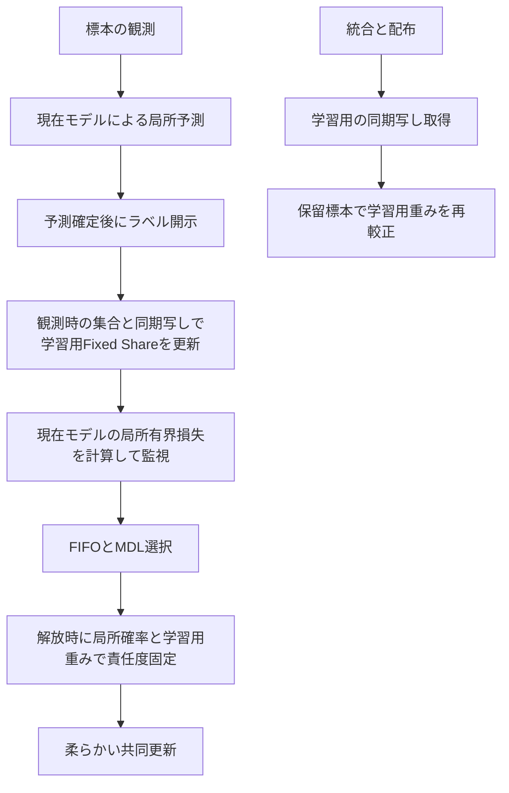

# Design Document

## Overview
新構成は柔らかい学習と現在モデルによる単体予測を組み合わせる。下書きの基点は`939489ec24df05dbe6129eedbbac454c590b735e`。調査は主担当内で行った。GPT-6 Luna mediumの独立レビュー（FAIL、2026-11-07）を受けて指摘を反映し、修正後の再確認は未実施。要求・設計・task・命名はいずれも未承認とする。

## Boundary Commitments
本specは新構成の接続と、責任度の事前重みを単体予測から分離する部分を担当する。既存の責任度計算、ストア、抽出、共同更新、集約、現在モデルの選択は再利用する。旧実装、既存結果、既存golden、既存構成の意味は変更しない。新しい外部依存は不要。

依存はsweepの宣言→runtimeの組立→機能別の学習・予測計算とする。runtimeの補助計算を下位の学習ストアから直接呼ぶ形は追加しない。設定の既定値は既存の保存表現から省く。承認後に重みの更新元・更新時点・再較正・公開名を変える場合は、影響taskの前に仕様レビューを受け直す。

## Existing Architecture Analysis

### 設定差分と合成の可否
`sweep/experiment_configurations.py`では、両構成とも`build_final_configuration_fedsda_run_settings`から作られる。

| 構成 | `fedsda`からの変更 |
| --- | --- |
| `fedsda-soft-training` | `training_assignment_strategy=responsibility_weighted_training`、`record_training_mass_by_concept=True` |
| `fedsda-single-model-prediction` | 予測方式`current_training_model_prediction`、パラメータ`current_local_parameters`、再較正方針`keep_weights_without_recalibration` |

**単純な合成は不可。** `runtime/fedsda_run_client_settings.py:220`は柔らかい学習をFixed-Share予測と共同更新に限定する。実際に両設定を生成し、softのclientへsingleの予測設定を`dataclasses.replace`で渡す読み取り専用の確認を行い、`RunSettingsValidationError`を確認した。設定検査を緩めるだけでも不十分である。

- `runtime/observed_sample_prediction.py:188`の単体経路は現在モデルだけを評価し、Fixed-Share・AdaHedgeの証拠を更新しない。戻り値の重みも現在モデルに1である。
- `runtime/released_sample_training_responsibilities.py`は、学習ストアへの追加時にFixed-Share ownerの重みを取得し、全保有モデルの**局所**パラメータで正解ラベルの確率を新しく計算する。単体経路のone-hotを渡せば固い学習へ退化し、ownerを放置すれば既存softとは異なる事前重みになる。
- `runtime/fedsda_run_client.py:484`は予測設定が再較正なしなら即returnする。`runtime/post_aggregation_prediction_recalibration.py:94`の再較正は保留標本の局所損失を再生するため、単体予測用の設定だけでは学習用の再較正まで失われる。
- 現在モデルは`CurrentTrainingModelAssignment`の状態。警報後のMDL選択・候補採用で変更され、配布時に`global_model_distribution_application.py`がID対応を反映する。softでもこのownerと固いストアは監視・判断用に残るので、「現在モデル」は未定義ではない。責任度最大モデルを意味しない。

### 学習の契約（既存softを再利用）
FIFO解放・警報区間確定・候補採用後の追加で、保有集合Mについて`q[i,m]=w[m]*p_local_m(y_i|x_i)/sum(w*p_local)`を一度だけ求める。分母0なら選択された現在モデルへone-hot。解放時点の局所パラメータとその時点の重みを使い、観測時の確率を使い回さない。

正の責任度を持つ標本数`c_m >= B`の保有モデルだけが参加し、`q/n_m`でB件を復元抽出し、batch平均損失を共同更新に使う。損失へ責任度を二重に掛けない。集約は概念固有部に`n_m=sum(q)`、共有部に参加モデルの`sum(n_m)`を使う。候補の初期学習は従来どおり。モデル追加で過去標本の新列は0、登録時は列を改名、統合時は対応列を加算して再正規化しない。既存ストアの保有外モデル・破棄の扱いも変えない。詳細の正本は既存softの設計と現実装である。

### 監視損失のコード上の事実（Major 1、2026-11-07）

以下の行番号は基点`939489ec`の`src/federated_learning_experiments/`からの相対パス。新構成は未実装のため、既存3構成で確認した事実と、新構成で維持する契約を区別する。

| 構成 | 検出器へ渡す損失と取得元 | 状態・予測方式との関係 |
| --- | --- | --- |
| `fedsda` | `runtime/observed_sample_processing.py`の`process_observed_sample`、439〜446行で現在IDのregistry上のclassifierを評価し、450〜461行で検出器へ渡す | 同期写しでなく現在の局所パラメータ。混合予測の損失ではない |
| `fedsda-single-model-prediction` | 同じ`process_observed_sample`の439〜461行 | 単体予測の戻り値も参照せず局所損失を別計算する |
| `fedsda-soft-training` | 同じ`process_observed_sample`の439〜461行 | 学習割当がsoftでも監視の定義は同じ |
| 新構成 | 上記の共通経路を維持する契約（まだ実行確認できない） | 学習用の同期損失列と独立。監視に渡す局所損失の定義を変更しない |

共通の呼出元は`runtime/fedsda_run_client.py`の`FedsdaRunClient.process_observed_sample`（245行、共通関数呼出し271行）。予測用同期写し・混合ownerの切替は323〜332行の予測用引数だけで、監視用classifierの選択は変えない。構成builderのsoft分岐は`sweep/experiment_configurations.py:535`、single分岐は556行で、監視の別経路は作らない。共通処理の349〜351行の説明とも一致する。

損失評価関数は`learning/prediction/classifier_bounded_loss_evaluation.py`の`evaluate_classifier_per_sample_bounded_losses`（146行）、内部の`_compute_per_sample_bounded_losses_from_outputs`（105行）。二値では`abs(p-y)`（114〜115行）、多クラスでは`1-p(y)`（116〜120行）の有界損失であり、学習の交差エントロピーではない。ラベル観測後、実予測処理（427行）の後・FIFO解放や警報対応による学習の前に評価し、現在モデルの統計から選ぶbaselineも同じIDで得る（447〜460行）。

従って、予測方式に従って監視信号を変える案の判断待ちは不要。同じモデル・入力・current ID・統計・検出器状態なら4構成の監視損失列と監視結果は一致させる。学習後に局所モデルが異なれば値・警報・FIFO・MDL・採用や統合の実現値が変わりうるが、これは共通定義へのモデルの違いの波及である。集計で「予測方式が直接監視損失の定義を変えた」と解釈しない。

## Open Questions / Risks

### D1: 学習用重み（案A、2026-11-07にユーザーが確定）
主担当の判断（2026-11-07）、ユーザーが2026-11-07に案Aを確定。以下の案Aを仕様書群の前提として採る。
**A: 学習用のFixed-Share状態を独立して維持する。** 既存softと同じ更新則を、新構成自身のモデルと観測に適用する。既存softの別runの重みや責任度をコピーする意味ではない。実際の予測は局所の現在モデルだけ。これが「学習はsoftと同じ」を最も保つ案である。

既存softでは、観測時のFixed-Share更新のモデル別損失は同期時の写しに由来し、責任度の確率は解放時の局所モデルに由来する。この非対称を維持する。同期と局所の混合係数βは責任度の式に使われず、学習用には作らない。同期の写しは配布後・再較正前に取得し、同期後の新モデルに対する写しの補完は既存の選択規則に従う。no_gradの補助評価でoptimizerやRNGを変えない。

**不採用案B: 一様事前重みを使う。** 実装は軽くなるが責任度の式の`w`が既存softと異なり、学習軸以外の比較条件が変わる。ユーザーが明示的にこちらを選ぶ場合は要求と論文上の説明を変更する。単体予測のone-hot重みを使う案は、柔らかい学習にならないため推奨しない。

### D2: 再較正と費用（案A、2026-11-07にユーザーが確定）
主担当の判断（2026-11-07）、ユーザーが2026-11-07に案Aを確定。
予測用の再較正は単体構成と同じく無し。学習用重みだけを、既存softと同じ配布後の保留標本の局所損失で再生する。責任度ストアの過去のqは固定したまま。AdaHedge・真の概念別証拠の再始動を学習用へ持ち込まない。予測が単体でも全モデルの補助評価と写しが必要なので、総MACやメモリが単体構成と同じになるとは保証しない。

D1・D2は案Aで確定した（主担当の選択を、ユーザーが2026-11-07に確定）。残るのは仕様レビューと承認。ユーザー確認と仕様レビュー指摘反映の確認・承認をそろえてから、主担当が実装開始可否を記録する。

## Components and Interfaces（案A）

| 部品 | 役割・契約 | 要求 |
| --- | --- | --- |
| 構成と設定 | 新構成を末尾登録。学習用重みの更新方針を型付き設定と宣言で分離 | 1.1, 2.3 |
| 学習用重み更新 | clientごとに専用FixedShareWeightControllerと同期写しを所有。既存と同じ損失列で逐次更新・再生 | 2.1, 2.2, 2.4 |
| client接続 | 実予測→学習用重み更新→監視・解放・学習の順序を既存処理に接続 | 1.2, 1.3, 1.4, 3.2, 3.3 |
| 記録・評価 | 実予測はsingleの記録、学習はsoftの記録、費用は両方を含める | 2.4, 3.1 |
| 比較の集計 | 保存設定から200キーと来歴を検査し、4マスの対の差を出力 | 4.1, 4.2, 4.3, 4.4 |

### 設定とowner
`FedsdaRunClientSettings`へ`training_responsibility_weight_update_policy`を提案する。既定値`prediction_weight_updates`は保存から省き、従来softは従来の予測用ownerを借用する。追加値`independent_fixed_share_weight_updates`は新構成でだけ使う。型・宣言で、soft学習＋共同更新＋現在モデル予測＋局所パラメータ＋予測の再較正なし、の組に限定する。従来のsoft＋AdaHedgeや逐次学習の拒否は維持する。

専用ownerはclient組立時に一度作り、責任度providerへ注入する。実予測の戻り値の`observed_losses_by_model_id`等は現在モデルだけのままにし、補助評価の全モデル損失で置換しない。監視は共通経路で局所損失を別計算し、予測の戻り値にも補助損失列にも依存させない。同期写しも実予測のパラメータ選択から独立させる。

### 記録
実予測は現在IDの重み1・実効モデル数1、各種の比較正否も現在モデルの正否、結合予測の標本数0というsingleの意味を保つ。`held_model_sample_count`は保有モデル延べ数で、実際に予測したモデル数ではない。補助評価をした事実を、この予測診断の意味変更に使わない。

`training_mass_by_concept.*`、`training_responsibility.effective_model_count`、`soft_training_update.participating_model_count`、`soft_training_batch.duplicate_sample_fraction`を既存どおり保存する。真の概念は診断用に限り、重み・選択・学習に入れない。新しい必須表や既存列の型変更は予定しない。追加費用は既存のモデル計測器で推論として計上する。

### 照合と費用の検査契約

既存softの詳細粒度は[既存設計](../fedsda-soft-training-assignment/design.md)と[検査記録](../fedsda-soft-training-assignment/tasks.md)に合わせる。次のS1〜S6をtasks.mdの完了条件に対応させる。式をtestへ複製した正解値だけで済ませず、同じ初期状態から既存の実メソッドを対照として別々に実行する。モデルを実際に初期化した後の乱数状態を基準とし、owner間の共有参照で対照まで書き換わらないよう独立した状態を作る。

| 検査 | 固定する入力と既存の対照 | 照合する出力・状態 |
| --- | --- | --- |
| S1 観測と監視 | 局所と同期の値が意図的に異なる複数モデル、current ID、統計、検出器、標本列を共通化。単体予測は`_predict_with_current_training_model_only`、重み更新は`predict_observed_sample_and_update_prediction_weights`のsoft経路、監視は`process_observed_sample` | 実予測の確率・ID・重み1・記録はsingle対照。同期のモデル別損失列とFixed-Share更新前後の重みはsoft対照。局所監視損失列・baseline・log-e・警報は4構成で一致。予測が変わる入力も含め、監視が変わらないことを検査 |
| S2 解放と学習 | `build_released_sample_responsibility_provider`（`released_sample_training_responsibilities.py:24`）のregistryとownerを同状態にして既存softと新構成へ注入。FIFO解放・警報区間確定・採用後追加を通す | 解放時の全局所正解確率、重み、qの全列とID順、分母0のfallback・微小分母。同期損失列とは別にspyで照合。`ResponsibilityWeightedTrainingStore.sample_batches`で参加ID（正の標本数がB未満／ちょうどB／超過）、抽出分布q/n、同じRandom状態での抽出結果・順序・重複・学習前後の乱数状態を比較 |
| S3 共同更新と集約 | 同じ重複batchを既存`held_model_joint_training_iterations`経路へ渡し、同じ局所状態を既存`server_model_registration_and_aggregation`経路で処理 | loss・全パラメータ・grad・optimizer state（SGD、Adam standard、AMSGrad）。責任度を二重掛けしないこと。集約に実際に渡るheadのn_m・共有部の参加モデル分sum(n_m)、登録ID、集約後の全パラメータとモデル対応を照合 |
| S4 配布と再生 | 配布・統合済み局所モデル、保留標本の観測順、Fixed-Share初期状態を共通化。対照は`post_aggregation_prediction_recalibration.py`の`_compute_pending_sample_loss_sequence`（39行）と`recalibrate_prediction_state_after_aggregation`（94行）のFixed-Share結果 | 同期写し取得→保留の局所損失列→再生の順、再生前後の重み、件数・ID、空保留／1モデルのno-opを照合。過去q、実予測owner、モデル値・grad・optimizerは不変。追加IDの過去列0、登録時の改名、統合時の列加算（再正規化なし）、保有外の標本の扱いを検査 |
| S5 RNGと入力 | `RunRandomSources`（`execution/run_random_sources.py`）のrun所有RandomとRandomState、torch CPU状態、呼出元global Python/NumPyを固定。データ生成はrunのRandomState、batch抽出は借用Random、モデル初期化はtorchの既存scope | 補助観測・写し取得・再生の各前後で全状態一致。別のRNGの作成・seedリセットで一致を装わない。4構成でモデル初期化数・順序・値、入力生成の呼出し順と全clientの特徴配列（dtype・shape・値／digest）・ラベル・概念・標本indexを比較。soft対照で同じ学習操作を固定したときのbatch消費は一致、異なる学習軌跡の最終Random状態の一致は要求しない |
| S6 費用 | 同じ複数モデル・入力・保留件数で、既存`measure_model_computation`と既存single／soft経路を実行。補助評価有無の差分を取る | 下記の計数の増分、不要な逆伝播・optimizer stepなし、写しの保持、追加通信なしを照合。計測あり／なしで予測・重み・学習結果・RNGが不変 |

S6の費用の対応を次のように固定する。

- `learning/models/model_computation_measurement.py`の`ModelComputationCounts`の`shared_part_inference_example_count`、`concept_specific_part_inference_example_count`、両部の`*_inference_forward_multiply_accumulate_count`へno_gradの補助評価と再生を計上する。共有特徴を再利用した場合も実行したforwardの回数を測り、仮想的に全モデル分を加算しない。コピー自体はforward MACではない。
- `runtime/fedsda_measured_run_execution.py`の計測scope内に接続し、観測時は局所処理、配布後の再生は同期処理の計数へ含める。`evaluation/computation_cost_summary.py`の`client_forward_multiply_accumulate_count`、共有部／概念固有部のforward内訳、forward＋推定backwardの標本あたり総計まで増分を照合する。補助評価だけではtraining forward・推定backward・optimizer stepは増えない。サーバ計算は同じ集約・統合入力の対照で一致させる。
- 既存run経過時間の測定scopeに補助観測・写し取得・再生をすべて含める。testでは時間の数値一致や速度向上率を要求せず、既存計測scopeに入ることをspyで確認する。学習用同期写しの独立したstorageと保持パラメータbyte数を検査記録に残す。既存成果物にpeak RSS等のメモリ実測はないため、集計はN/Aとし、写しbyte数からpeak RSSを推定しない。メモリの標準指標追加は本specの対象外。
- 重み・同期写しはclient内で計算し、新しい送受信payloadを作らない。同じ固定イベントとパラメータを既存通信計測へ通し、上り・下りbyte、送受信モデル数の増分0を検査する。全体runでは学習後のモデル数・警報等が変わり通信も変わりうるため、singleと総byteが一致するとは要求しない。比較表にはMACだけでなく上下通信・時間・メモリ未測定を併記する。

### 既存構成とgoldenの固定基準

Task 1の変更前に基点HEAD（この調査では`939489ec24df05dbe6129eedbbac454c590b735e`）の全`EXPERIMENT_CONFIGURATION_NAMES`を順序付きで取得し、既存soft testの`build_settings`と同条件（SINE2・seed0・2 client・300標本/client・間隔50）で、保存設定のplain mapping全体・そのSHA256・`make_run_identifier`を固定する。実装時にHEADが変わっていれば新しい基点と差分理由を記録し、変更前に取得する。実装後のbuilderから期待値を作らない。

新fixture案は`tests/refactoring/soft_training_single_model_prediction_existing_configurations.json`。基点・条件・取得手順も保存する。既存`soft_training_existing_configuration_hashes.json`はsoft追加以前の構成を守る資料として保持し、値を変更しない。新fixtureは既存softと診断構成も含む全構成を対象にする。Task 4の最終証拠は、新fixtureの全行が一致し、一覧が旧一覧＋新構成1件だけ、既存の保存mapping・hash・識別子が一致し、新構成だけがdesignの設定差を反映すること。既存testの構成末尾位置に関する期待は意味を保って更新する。

goldenの範囲は`tests/refactoring/behavior_regression_goldens/v1/`〜`v16/`各環境JSONの全保存ケース（`behavior_golden_cases.py`の`CASE_NAMES_BY_BASELINE_VERSION`）とする。Windowsで`test_important_behavior_regression_goldens.py`を通し、既存の`run_settings`・`run_metrics`・`record_tables`・`global_parameters`の値を照合する。`behavior_random_state_cases.py`と`golden/fedsda_without_candidate_validation_random_states*.json`を使う既存検査も維持する。golden／乱数fixtureのパス・SHA256を実装前後に比較し、追加・削除・再生成・期待値更新で成功させない。Linux版は既存WSL手順に従い、実行環境と未実施理由を別記する。

soft・singleは非golden保護構成なので、goldenだけで旧3構成すべての数値不変を主張しない。実装前の既存3構成のSINE2・MNIST4小run（既存soft testの1500／800標本、seed0・2 client・間隔50）から全既存表の列・dtype・値とrun_metrics（秒以外）、警報・選択・登録・統合のイベント列、最終パラメータ、入力系列を固定して比較する。経過秒はscope検査だけとする。実runで統合が起きなければS4の固定入力で補い、発火したと誤記しない。

検証コマンドは[共通引継ぎ手順](../../steering/agent-handoff.md)の固定venv・環境変数を用いる。対象は新規専用test、`test_fedsda_soft_training_configuration.py`、`test_fedsda_configuration_variants.py`、`test_important_behavior_regression_goldens.py`、`test_single_run_dependency_boundaries.py`、旧`tests/test_regression.py`・`tests/test_proposed_regression.py`。最終は`python -m pytest tests -q -p no:cacheprovider -n 12 --dist loadfile`（slow除外なし）、Ruff・Pyright・pip check・`spec_checks.py identity`とする。各実行のコマンド・環境・検査名・成功件数・skipと理由をtasksのNotesに残す。この仕様修正ではいずれも未実施である。

## File Structure Plan
以下は実装時の見込み。この依頼ではsource・test・既存文書を変更しない。

| ファイル | 作業の見込み |
| --- | --- |
| `src/federated_learning_experiments/sweep/experiment_configurations.py` | 定数、新構成、両軸の設定と学習用重み方針の組立 |
| `src/federated_learning_experiments/runtime/fedsda_run_client_settings.py` | 型付き方針、既定の保存省略、限定した組の受理 |
| `federated_drift_experiment/experiment_spec/options.py` | 既存OptionSpecの説明、新方針のOptionSpec・ActivationRule・ChoiceConstraint。新方式を条件分岐だけに隠さない |
| `src/federated_learning_experiments/runtime/training_responsibility_weight_updates.py`（新規案） | 同期写しによる学習用重みの観測更新、局所保留損失によるFixed-Shareだけの再生 |
| `src/federated_learning_experiments/runtime/fedsda_run_client.py` | owner生成、provider注入、同期写し・再較正の接続 |
| `src/federated_learning_experiments/runtime/observed_sample_processing.py` | 実予測後・解放前に学習用重み更新を挿入する明示的な接続 |
| `src/federated_learning_experiments/runtime/released_sample_training_responsibilities.py` | owner注入の契約・説明の見直し。責任度の式は変更しない |
| `src/federated_learning_experiments/runtime/post_aggregation_prediction_recalibration.py` | 必要なら損失列計算の共用境界だけを整理。既存再較正の値・順序は維持 |
| `tests/refactoring/test_fedsda_soft_training_single_model_prediction.py`（新規案） | 新しい組、独立重み、実予測、全体runの接続検査 |
| `tests/refactoring/soft_training_single_model_prediction_existing_configurations.json`（新規fixture案） | 変更前HEADの全構成の順・保存mapping・hash・識別子と取得条件。既存fixtureは保持 |
| `tests/refactoring/test_fedsda_run_client_settings.py`、`test_settings_serialization.py`、`test_experiment_sweep.py`、`test_fedsda_configuration_variants.py` | 組と保存設定と一覧・識別子の回帰 |
| `tests/refactoring/behavior_golden_cases.py`、`test_single_run_dependency_boundaries.py`、`fresh_process_smoke.py`、`tests/conftest.py` | 非golden保護への追加、依存許可、fresh接続、必要ならslow登録 |
| `tools/aggregate_soft_training_single_model_prediction.py`（新規案） | 既存結果を変更しない専用の対照集計CLI |
| `docs/experiments/experiment-sweep.md`、`docs/reference/options.md`、`docs/experiments/experiment-log.md` | 構成の説明、生成コマンドによる設定参照、実験開始後の台帳 |

旧`mode_names.py`と`experiment.py`の`MODE_SPECS`は旧実装向け規約であり、今回は新しい通信手法ではなく新srcの構成追加なので変更しない。新しい数値パラメータ・掃引軸・標準指標は増やさないため、`parameters.py`・`SWEEP_DEPENDENCIES`・`SweepAxis`・`metrics.py`の新規登録は予定しない。実装時に設定や指標を増やすなら各正本への登録と再レビューを行う。

## Testing Strategy
上記S1〜S6と固定基準を検査の正本とし、以下の概要だけで完了とはしない。Task 2・3・4・5・6にそれぞれ照合出力と合格条件を記載する。
- 固定状態の単体予測を既存single経路と比較する。補助評価が他モデルを参照しても、実予測の確率・ID・記録が変わらない。
- 同じ状態・入力・同期写しで、学習用の更新前後の重みを既存softのFixed-Share経路と比較する。複数標本・集合変更・候補追加を含める。正解式をtestへ複製しない。
- 集約後の再生を既存再較正のFixed-Share結果と比較し、実予測の重み状態と固定済みqが変わらないことを確かめる。同期写し取得と再生の順序も検査する。
- current ID変更・登録IDへの置換・統合ID対応で、予測のcurrentと責任度の全列が別の役割を保つことを確かめる。
- SINE2とMNIST4の小さい全体runで警報・候補・複数モデルの柔らかい更新を実際に通す。規模は既存softのSINE2 1500標本/client、MNIST4 800標本/client、2 client、seed0、間隔50を起点に、実装担当が経路の発火を確認して決める。起きない統合は固定入力で補う。別構成間の全軌跡一致は要求しない。
- 既存全構成について実装前HEADで取得した名前・順・保存設定・run識別子を固定fixtureと照合する。新構成の識別子には新しい設定差が反映されることを確認する。
- 共通手順の対象test・スキーマ・依存境界・fresh process、基準版1〜16のgolden、`tests/test_regression.py`・`tests/test_proposed_regression.py`、全pytest（`--dist loadfile`）、Ruff・Pyright・pip checkを実装段階で実行する。既存softの古い全pytest後の部分再実行記録を、今回の全検証の代わりにしない。

## 本規模の実行と対の集計

### 200 runと出力
データは`sine2 circle2 sea2 sea4 mnist2 mnist4 fmnist2 fmnist4 rotmnist2 rotmnist4`、集約間隔50・500、seed0〜9、10 client、5000標本/client。新構成だけ200 run。主担当による検証後、uraniumで数値ライブラリ各1thread、64 workersを標準とする。既存soft実験の100 workersは過去の実測であり、そのまま既定にはしない。

予定保存先は`results/fedsda-soft-training-single-model-prediction-v16/<開始時刻>_soft-single-i50-i500-seeds0-9/`。実装と検証が済んでから主担当が内部で読み取り専用の計画確認と重複先の点検を行う。この下書きでは長時間実験の実行コマンドを作成・実行していない。目的・labelを指定し、duplicate-policyはerrorを維持する。研究結果はGitへ含めない。

### 既存結果の所在と今回の確認
下表のパスはすべて`results/`からの相対パス。間隔100・200を除いて使う。

| 比較対象 | 保存先 | 対象件数 |
| --- | --- | ---: |
| soft＋混合 | `fedsda-soft-training-v16/20261105_182656_soft-vs-hard-i50-i500-seeds0-9/fedsda-soft-training/` | 200 |
| 固い＋単体、6データ | `fedsda-component-ablation-v16/20261029_231413_core-components-v16-seeds0-9/fedsda-single-model-prediction/` | 120 |
| 固い＋単体、追加4データ | `fedsda-component-ablation-new-datasets-v16/20261031_062435_warm-start-and-single-model-seeds0-9/fedsda-single-model-prediction/` | 80 |
| 固い＋混合、6データ | `fedsda-component-ablation-v16/20261029_231413_core-components-v16-seeds0-9/fedsda/` | 120 |
| 固い＋混合、追加4データ | `fedsda-every-sample-change-interval-search/20261029_172159_new-datasets-seeds0-9/fedsda-every-sample-change-interval-search/` | 80 |
| 固い＋混合の記録付き照合用 | `fedsda-soft-training-v16/20261105_182656_soft-vs-hard-i50-i500-seeds0-9/fedsda-training-mass-diagnostics/` | 200 |

2026-11-07の読み取り専用調査で、各対象のrun JSONを全件解析し、同名キーの重複なし、参照先NPZの存在、run_summaryの総件数を確認した。softの200キーはsingle・既定・診断の各200キーと一致した。全件client10・標本5000、保存された環境はLinux x86_64、Python3.10.16、NumPy2.2.6、Torch2.12.1+cpuで一致。

保存設定を再帰比較したところ、soft対診断は学習割当の1項目だけ、soft対既定は学習割当と学習量記録の2項目だけ、soft対singleは上記2項目と予測の3項目だけが異なった。診断対既定の精度は200対すべて完全一致した。追加4データの既定は来歴上は基準版15・commit`541989d1`であることを保持する。設定が版16と同じであることを確認したうえで、結果の別名対応を分析側だけで明記する。既存run名を改名しない。

soft・診断はcommit`399dd59f`、6データの既定は`de65e59c`。コミットが違うことを隠さず、実装時には既存経路の不変性を回帰testと設定比較で裏付ける。今回の調査ではNPZ配列の全内容・入力画像のdigest・全指標・各summary行とJSONの相互一致までは検算していない。設定とseedの一致を入力全系列の直接一致と表現しない。

### 集計前の照合契約
1. 正本のJSONの実行条件から`dataset, interval, seed, client_count, per_client_sample_count`をキーにする。ファイル名の文字列分解だけに頼らず、構成名・run_identifier・summary・参照NPZと突き合わせる。期待する集合を10×2×10で先に作り、4構成各200件の一意性を要求する。
2. 比較対象ごとに設定差の許可表を用意する。新構成対softは実予測の3項目と新しい独立重み方針、新構成対singleは学習割当・学習量記録・独立重み方針、新構成対fedsdaはその和に限定する。新方針の省略は既存の既定として解釈し、それ以外の設定差は停止する。診断構成・版15の別名はこの明示表でだけ対応付ける。
3. concept schedule、初期学習・batch・optimizer・検出・FIFO・候補・統合、入力データの取得条件まで完全設定を比較する。環境・実装来歴・behavior baselineを記録し、版番号一致だけで受理しない。新コード側の入力生成・既存3経路が変わっていない証拠を残す。
4. 失敗・重複・欠損・読めないNPZは停止して一覧を出す。入力系列のラベル・概念等が保存されていれば対で照合し、画像digestが無ければ直接画像照合は未実施とする。入力の独立性はRNGの所有と生成順のtestも根拠にする。照合不足が残るときは、主担当とユーザーに再利用可否を戻し、自動再実験しない。

上記3・4のtest証拠はTask 3のS5（初期化順・入力生成順・全client入力照合）を使う。検査用固定入力にはラベル・概念・順序・特徴digestの不一致、環境／来歴の欠損、summary対JSONの矛盾を含め、同seedであることだけで受理しない。4構成の監視損失の定義は共通であることと、学習後の数値・イベントは異なりうることを分析の前提に明記する。

### 出力と統計
集計CLIは新規結果ルートと既存の各ルートを引数で受ける。既存のGit管理外`results/fedsda-soft-training-v16/aggregate_soft_training.py`は集計方法の参考とし、変更・importや外部の論文checkoutへの依存を追加しない。出力は新規結果ルートの`analysis_pairing_check.csv`、`analysis_soft_training_single_model_prediction.csv`・`.md`。既存CSV・JSON・NPZは読み取り専用。

Hmix=`fedsda`、Hsingle=`fedsda-single-model-prediction`、Smix=`fedsda-soft-training`、Ssingle=新構成とする。20セルごとに4構成の平均を示す。主比較はSsingle−Smix、補助にSsingle−Hsingle・Ssingle−Hmix、予測の利得Smix−SsingleとHmix−Hsingle、その差を示す。差は各seedの対で先に求め、10個の差の平均±`t(0.975,9)*SD/sqrt(10)`、符号別seed数を出す。精度の差はpp。

全体行はseedごとに20セルを等重み平均した10値から同じ区間を求める。200runを独立の標本として区間を狭めない。差の差は2軸の相互作用の記述であり、モデルの多様性だけが原因という因果主張には使わない。

上下byteを別々に示し、合計、計算量の計数とMAC/処理標本、経過時間、最終保有モデル数を併記する。時間は実行worker数・ホスト負荷が違うので記述値とし、アルゴリズムの高速化率を断言しない。純度は既存定義のclient平均→run→seed平均、欠損数と1モデル基準を併記。通常fedsda・singleに学習量表が無ければN/Aとし、診断構成による補助値を別欄にする。責任度実効数・参加数・batch重複はsoft2構成のみで比較する。概念別・期間別は保存済み系列から同じ既存定義で導出できる範囲を記し、未保存は明記する。

## 命名・役割レビュー
公開名の案はnaming.md。共通引継ぎ手順に従い、独立CLIの仕様書群レビュー1回と指摘反映を実装前に行う。本依頼はレビュー指摘の反映まで。FAILと指摘の反映を記録し、承認・PASSには変更しない。
