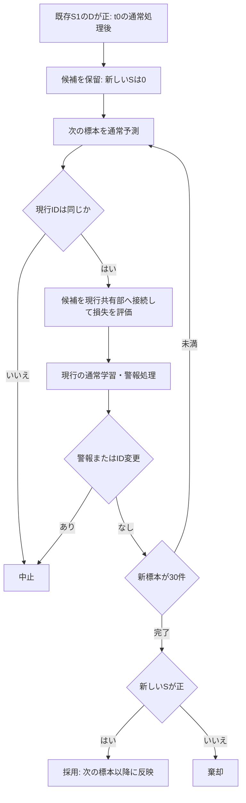

# 再接続後の新しい標本で候補を評価する対照（2026-10-24）

ユーザー依頼の研究用設計と手元検証。既存S1のDも学習前の逐次損失差だが、影は凍結共有部で判定されていた。[前回の対照](fedsda-shadow-current-comparison-20261024.md)では、学習済み直近窓の比較だけでは将来の劣化を選別できなかった。今回はD>0を採用の決定ではなく「再接続した候補の評価開始」に変える。製品・既存研究ツールを変更せず独立ツールで検証する。本実装とする場合だけcc-sddへ進む。

## 主対照の設計

1. **開始**: 既存S1のD>0で即時採用するはずの標本`t0`を処理し終えた時点で、影の概念固有部とoptimizer状態をコピーして保留する。`t0`以前の標本やDの累積値は、新しい判定の証拠に加えない。通常の予測・学習・通信は現行のまま続ける。
2. **候補の状態**: 概念固有部は保留中に学習しない。共有部は現行モデルの実体へ接続し、各評価前に接続を更新する。現行の通常学習・サーバ同期が更新した共有特徴を候補も使う。候補から共有部への勾配更新はしない。採用直前に別の凍結共有部から付け替える不整合を残さないための選択である。候補を学習しないことによる不利益は、待機対照と比較して扱う。
3. **新しい標本だけで評価**: 同clientの`t0+1`以降の30標本で、通常のモデル更新より前に現行と候補の対数損失を同じ標本について測る。正解ラベルはその標本の予測後に到着したものを使い、採用が影響するのは次の標本以降。候補は評価標本で学習しない。現行は通常どおり学習する。
4. **固定窓の一度だけの判定**: `S=sum(loss_current-loss_candidate)`を0から蓄積する。30標本が揃うまでSの正負で早期採用しない。30件目の通常処理が終わり、新しい警報や学習帰属の変更がなければ、`S>0`のときだけ採用。同値は棄却。これは予備的な単純対照で、統計的有意性や誤採用確率を保証する検定ではない。30は既存診断と揃えた固定値で、最適値ではない。
5. **中止**: 新しい警報、現行の学習帰属ID変更（正式登録による変更も含む）、新しい保留候補への置換で中止する。現在と異なる状況をまたいで古い候補を採用しない。run末の30件未満は打切りとし、採用・棄却へ数えない。真の概念は事後記録だけに使い、継続や中止を決めない。
6. **採用**: 概念固有部とoptimizerは評価開始時の状態を継続し、現在の共有部へ接続したまま既存の登録待ち経路へ渡す。初期統計の標本は元の影が実際に学んだ標本で、保留中の評価標本を候補学習済みとして水増ししない。帰属保留窓は採用時点の通常状態を使う。

現行IDの変更による中止は保守的で、正式登録だけで評価を捨てる例もあり得る。初回はこの規則を固定して件数を報告し、中止が多すぎる場合だけ別対照として変更する。

候補も各標本の評価後に学習する案は情報漏洩ではないが、最初の対照では共有部再接続と概念固有部の追加学習を分けるため、概念固有部を固定する。このため通常学習を続ける現行より不利になる可能性がある。その影響は待機のみ対照にも共通で、今回の結果を「学習を続ける候補すべて」の性能へ一般化しない。

比較相手は現在の学習帰属モデル単体で、既存モデル群の混合予測ではない。候補がこの比較で勝っても、実際の混合予測の精度改善を保証しない。4構成の標準指標で実際の利得を確認する。



Sは以前の「影−現行」の損失差と符号が逆で、**正が候補に有利**。待機のみ対照は図の最後のS判定を通さず採用する。run末は30件未満なら打切り。

## 4構成と費用

| 構成 | 動作 | 何を分けるか |
| --- | --- | --- |
| 既定 | 影の実採用なし | 元の製品基準 |
| 即時採用 | 既存S1のD>0で採用 | 既存の研究試作 |
| 待機のみ | 同じ候補・共有部追随・中止規則で30件待ち、Sの符号によらず採用 | 待機と概念固有部の学習停止の影響 |
| 新標本ゲート | 同じ30件を待ち、S>0の場合だけ採用 | 待機対照からの選別効果 |

待機のみ対照でも同じ損失差を計測する。保留中に同じ処理を行う機構のablationであり、無評価の待機方式の最小費用を示すものではない。採否でその後の経路と候補数が変わるため、run全体の計算量が等しいとは限らない。新標本ゲートの評価は採否に必要な演算なので、今回のMACから差し引かない。標準MACには影の生成・継続と、保留中の二つの評価も含む。追加評価の計数は別にも保存する。秒は準備・計測・通常処理と並列負荷を含む。

## 保存・検証・実験規模

- `tools/research_reconnected_candidate_holdout.py`へ隔離する。1jobは同一のデータ・seed・間隔の4 run。各構成の精度・既定との差pp・上り/下り通信・MAC・秒を保存する。
- 追加記録は開始位置、元のD、評価前の現行ID、30標本それぞれの損失と累積S、採用/棄却/中止/打切り、その理由、採用位置・待機長。真の概念は診断列のみ。
- 主実験は**2500標本/client・10clients、SEA4/SINE2の通常と固定概念（計6入力）、間隔100、seed0/1、12条件・48 run、12workers**。1500標本は使わない。初回の探索なので間隔500・seed2以降の一般性は未検証とする。
- 専用testは開始標本の除外、30件未満の採否禁止、評価後の通常学習前の順序、候補の概念固有部不変、共有部の追随、同値棄却、警報/ID変更/末尾の中止、元の影の記録と新しい候補記録の分離を検査する。保留0の即時モードが既存S1と全保存値・MAC・採用記録で一致することを、2500標本の実NNでも確認する。

実行した手元コマンド（同じ出力を再使用せず、再実行時は別ラベルを指定する）:

```powershell
$env:OMP_NUM_THREADS='1'; $env:MKL_NUM_THREADS='1'; $env:OPENBLAS_NUM_THREADS='1'
../../venv/Scripts/python.exe -m tools.research_reconnected_candidate_holdout --output results/fedsda-reconnected-holdout/20261024_pilot-seeds0-1-n2500-w30 --datasets sea4 sine2 --intervals 100 --seeds 0 1 --sample-count 2500 --horizon-samples 240 --window 30 --workers 12
```

## 2500標本の結果

主実験は`results/fedsda-reconnected-holdout/20261024_pilot-seeds0-1-n2500-w30`へ保存した。12条件・48 runが全件完了し、失敗0、重複・欠落なし。250実行ソースのSHA256が現在の対応ファイルと一致。入力JSONを変更せず、結果内の`audit_holdout_results.py`で全記録を再検算し、`summary_audit.json`へ入力・全36トレース・分析コードのhashと補助集計を保存した。

検算では、評価標本が開始位置より後で連続し、最長30件であること、元S1の正のDとの対応、累積Sの再計算と有限性、採用/棄却の条件と位置、元S1の引渡し記録と実採用IDの分離を確認した。評価の共有部/概念固有部の推論件数がそれぞれ評価標本数の2倍で、候補の学習計数が0であることも検査した。採用0件のrunはMAC・秒以外の全保存値が既定と一致。gateで棄却0件のrunは、秒以外の全保存値がwaitと一致した。

### 精度差の比較

各行2seed平均、既定との差pp。ゲートと待機のみとの差も丸め前の値から算出。

| データ | 入力 | 即時採用 | 待機のみ | 新標本ゲート | ゲート−待機のみ |
| --- | --- | ---: | ---: | ---: | ---: |
| SEA4 | 通常 | +0.1380 | +0.0380 | +0.0460 | +0.0080 |
| SEA4 | 概念0固定 | +0.0000 | +0.0000 | +0.0000 | +0.0000 |
| SEA4 | 概念2固定 | +0.0700 | +0.1080 | −0.0040 | −0.1120 |
| SINE2 | 通常 | −0.2940 | −0.2260 | −0.2260 | +0.0000 |
| SINE2 | 概念0固定 | +0.0100 | −0.0640 | −0.0360 | +0.0280 |
| SINE2 | 概念1固定 | +0.0560 | +0.0440 | +0.0360 | −0.0080 |

ゲートは既定に対して2条件改善・1同値・3低下。即時採用に対して1改善・1同値・4低下。待機のみ対照に対して2改善・2同値・2低下で、一貫した改善は得られなかった。これは条件の平均の符号を数えたもので、有意差を意味しない。2seed・間隔100だけの探索であり、以前のuraniumの5000標本・10seedの符号が再現するかは未検証。

### 採用・棄却・中止

| データ | 入力 | 待機のみ 開始/採用/警報中止 | ゲート 開始/採用/棄却/警報中止 |
| --- | --- | ---: | ---: |
| SEA4 | 通常 | 7/4/3 | 6/3/1/2 |
| SEA4 | 概念0固定 | 0/0/0 | 0/0/0/0 |
| SEA4 | 概念2固定 | 10/9/1 | 9/2/7/0 |
| SINE2 | 通常 | 5/3/2 | 5/3/0/2 |
| SINE2 | 概念0固定 | 2/2/0 | 3/2/1/0 |
| SINE2 | 概念1固定 | 4/4/0 | 6/4/2/0 |
| 合計 | | 28/22/6 | 29/14/11/4 |

評価標本はwait計719件、gate計783件。両構成でID変更・候補置換・run末打切りは今回0。即時採用は24件だった。採否がその後の予測・学習・警報を変えるので、24/28/29件は同じ候補集合ではなく、候補単位で一対一に対応させない。SEA4概念0固定はS1の採用条件に達したもの自体が無く、ゲートが全件を棄却したという意味ではない。

SINE2通常は完了した候補3件がすべてS>0で採用され、ゲートによる棄却は0。wait/gateの全保存値が秒以外一致したため、即時採用からの+0.068ppの差は新しいSによる選別ではなく、共通する待機・候補固定・中止規則の対照側の差である。それでも既定より−0.226ppで、現行単体への優位は混合予測全体の改善を保証しなかった。

SEA4概念2固定のゲートは7件を棄却したが、waitの平均+0.108ppを超えなかった。seed0ではwait−0.052→gate−0.008ppと低下を減らす一方、seed1ではwait+0.268→gate+0.000ppで利得も失った。負のSの候補が全て無用だったという解釈は支持しない。候補の採用後の学習や混合重みの影響は、この集計だけでは個別に特定できない。

SEA4通常の真の概念2精度差は、即時+0.1678、wait−0.0376、gate+0.2258pp。全体精度の差とは別の指標で、2seedだけの結果である。概念2固定の結果と合わせ、概念2へ一般的に有効とはまだ言えない。

### 標準指標

baseline=既定、immediate=即時採用、wait=待機のみ、gate=新標本ゲート。全て2500標本/client・10clients、間隔100、seed0/1の平均。MACは追加評価を含む。MACはモデルの順伝播と推定逆伝播で、全CPU演算数ではない。秒は12workerと専用test等の同時実行の負荷、baseline→immediate→wait→gateの順序を含む。SINE2通常のwait/gateはMAC等が全て同じでも秒が大きく違っており、時間差を方式の高速化とは解釈しない。

| データ | 入力 | 間隔 | 構成 | 精度% | 差pp | 上りMB | 下りMB | G MAC | 秒 |
| --- | --- | ---: | --- | ---: | ---: | ---: | ---: | ---: | ---: |
| sea4 | drift | 100 | baseline | 85.272 | +0.0000 | 1.773 | 1.839 | 4.136 | 182.03 |
| sea4 | drift | 100 | immediate | 85.410 | +0.1380 | 1.780 | 1.956 | 4.104 | 196.45 |
| sea4 | drift | 100 | wait | 85.310 | +0.0380 | 1.777 | 1.933 | 4.077 | 205.10 |
| sea4 | drift | 100 | gate | 85.318 | +0.0460 | 1.778 | 1.944 | 4.248 | 229.89 |
| sea4 | fixed0 | 100 | baseline | 87.714 | +0.0000 | 1.773 | 1.839 | 4.020 | 177.92 |
| sea4 | fixed0 | 100 | immediate | 87.714 | +0.0000 | 1.773 | 1.839 | 4.033 | 188.51 |
| sea4 | fixed0 | 100 | wait | 87.714 | +0.0000 | 1.773 | 1.839 | 4.033 | 194.04 |
| sea4 | fixed0 | 100 | gate | 87.714 | +0.0000 | 1.773 | 1.839 | 4.033 | 225.19 |
| sea4 | fixed2 | 100 | baseline | 87.988 | +0.0000 | 1.777 | 1.933 | 4.119 | 207.39 |
| sea4 | fixed2 | 100 | immediate | 88.058 | +0.0700 | 1.817 | 2.190 | 4.613 | 246.02 |
| sea4 | fixed2 | 100 | wait | 88.096 | +0.1080 | 1.783 | 2.003 | 4.239 | 283.15 |
| sea4 | fixed2 | 100 | gate | 87.984 | -0.0040 | 1.777 | 1.921 | 4.177 | 180.95 |
| sine2 | drift | 100 | baseline | 98.614 | +0.0000 | 2.149 | 2.966 | 6.730 | 244.49 |
| sine2 | drift | 100 | immediate | 98.320 | -0.2940 | 2.144 | 2.837 | 6.710 | 241.53 |
| sine2 | drift | 100 | wait | 98.388 | -0.2260 | 2.155 | 3.106 | 6.815 | 293.55 |
| sine2 | drift | 100 | gate | 98.388 | -0.2260 | 2.155 | 3.106 | 6.815 | 157.73 |
| sine2 | fixed0 | 100 | baseline | 99.274 | +0.0000 | 1.741 | 1.807 | 3.980 | 179.28 |
| sine2 | fixed0 | 100 | immediate | 99.284 | +0.0100 | 1.742 | 1.831 | 3.994 | 182.16 |
| sine2 | fixed0 | 100 | wait | 99.210 | -0.0640 | 1.742 | 1.831 | 3.993 | 187.19 |
| sine2 | fixed0 | 100 | gate | 99.238 | -0.0360 | 1.743 | 1.854 | 4.007 | 228.98 |
| sine2 | fixed1 | 100 | baseline | 99.194 | +0.0000 | 1.738 | 1.760 | 3.950 | 179.21 |
| sine2 | fixed1 | 100 | immediate | 99.250 | +0.0560 | 1.743 | 1.854 | 4.179 | 187.21 |
| sine2 | fixed1 | 100 | wait | 99.238 | +0.0440 | 1.744 | 1.866 | 4.024 | 194.63 |
| sine2 | fixed1 | 100 | gate | 99.230 | +0.0360 | 1.744 | 1.877 | 4.019 | 229.43 |

追加評価だけのMACは全12条件合計でwait 0.002375G、gate 0.002582G。標準表から除いていない。各runの追加計数は`validation_counts`へ別保存した。4構成の元指標・予測/サーバ状態digest・概念別精度はresults.json、標準集計はanalysis_holdout.md/summary_holdout.jsonに保存した。

## 判断と次の一手

設計した保留・新標本の評価・採否・通常採用への接続は実行検証できた。一方、**30標本・候補の概念固有部固定のこのゲートを、性能改善として本実装へ進める根拠は得られていない。** 固定窓長や候補を固定する選択まで含む一つの対照の結果で、再接続後の検証方式すべてを否定するものではない。

次に実行する作業のおすすめは、到着したuranium来歴追跡結果の検算である。並行して設計できる候補は、現在の学習帰属モデル単体と、実際の混合予測のどちらを改善対象として判定すべきかの切り分け。今回SINE2通常はS>0で採用されても全体精度が下がったため、現行単体への対数損失の優位と混合予測の利得のずれを先に測る。これを主因と断定はしない。候補も評価後に概念固有部を学習する案は別の因子として比較できるが、まず判定対象のずれを調べる方を推奨する。

並行できるのはuraniumの本規模来歴追跡結果の確認で、**既存の即時採用方式**の候補が実際にどの重みで予測に使われたかを調べられる。今回の保留ゲートとは別の経路・規模であり、そのまま今回の候補の来歴とは対応させない。今回のゲートをそのまま大きく掃引したり、製品の既定を変えたりはしない。

## 検証・独立レビュー

- 独立CLI `gpt-6-luna`、effort=`medium`、session `01a16d1b-ed4f-7dd1-8cae-3356efbe6556`で設計・実装レビューPASS。Blocker/Major/Minorなし。基点`15f88abf`上の新module・専用checks・本設計を対象とし、予測/評価/学習/判定の順、共有部追随、候補学習標本の計数、MACへの追加評価の包含、記録の分離を依存コードと照合した。独立の実NN・専用test再実行は無し。ログは`results/_sol_prompts/reconnected-holdout-review.txt`。
- 実験に使ったmodule SHA256は`3e198080df8101bfbf0d228014538092d9cd9c5776af502f791adc805daea129`。
- スキーマ3種と`tests/test_regression.py`は29件成功（170.31秒）。製品全pytestと`tests/test_proposed_regression.py`は未実施（製品src未変更）。専用11件は2500標本の実NN一致検査も含めて全件成功（653.21秒）。主48 runの結果は上記に記録した。
- 主48 runも全成功し、上記の保存値監査を完了。Ruff format/checkと`git diff --check`も成功した。製品・既存研究ツールの変更はない。
- 結果レビューの初回session `01a16d31-0624-7811-b73c-9887a9c4da27`は、一時ディレクトリを作業場所にしたCLIから結果へ読取りアクセスできずBLOCKED。数値の不一致ではなく参照範囲の問題だったため、作業場所をworktreeへ揃えて独立セッションで再確認した。
- 最終結果レビューsession `01a16d32-1d3a-7512-a893-00be1ab84c3f`はPASS、Blocker/Major/Minorなし。同じ`gpt-6-luna`・effort mediumで集計成果物を読み、6群の精度差、条件ごとの勝/同/負、採否件数を独立に照合。固定headと中止規則の限界、MAC包含、時間差の扱い、現行単体と混合予測の区別、既存即時採用の来歴と今回のゲートを直接対応させない解釈を確認した。raw results/全トレースの監査アサーション、実NN・専用testは独立再実行していない。
- ログは`results/_sol_prompts/reconnected-holdout-results-review.txt`と`reconnected-holdout-results-rereview.txt`。原結果と同様にGit管理外。
